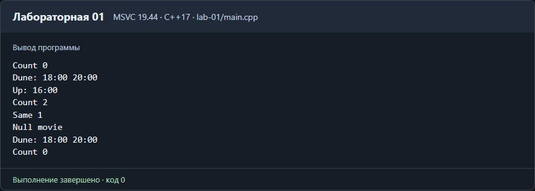

# Лабораторная работа 1

**Дисциплина:** Алгоритмы и структуры данных  
**Институт:** Институт информационных технологий и кибербезопасности  
**Кафедра:** Программная инженерия  
**Студент:** Зорькин Арсений Станиславович  
**Группа:** ПИЖ-б-о-25-2 (1)  
**Вариант:** 12  
**Уровень:** Базовый  
**Тема:** Композиция и агрегация классов. Статические члены

[Титульный лист](title.pdf) · [Код C++](main.cpp) · [Репозиторий](https://github.com/False4041/C) · [Папка работы](https://github.com/False4041/C/tree/main/lab-01)

## Цель работы

Освоить композицию и проследить время жизни частей объекта.

## Задание

Создать класс Document, который содержит объекты Page. У каждой страницы есть номер и текст. Показать порядок создания и уничтожения объектов.

## Как работает программа

У Document две страницы, хранящиеся в полях. Конструкторы страниц вызываются перед телом конструктора документа. При выходе из блока сначала выполняется тело деструктора Document, затем уничтожаются вторая и первая страницы.

## Сложность

Печать занимает O(L) времени, где L — суммарная длина текста страниц. Текст занимает O(L) памяти.

## Запуск

Один файл main.cpp, стандарт C++17. [Команды сборки](../README.md#сборка).

Демонстрация запускается без ввода.

## Результат

[Текст вывода](output.txt) и скриншот запуска в [OnlineGDB](https://www.onlinegdb.com/online_c++_compiler) в режиме C++17.

## Вывод

По выводу можно проследить, как объект Document управляет временем жизни своих страниц.

## Контрольные вопросы

Ответы на вопросы методички

**1. Что такое композиция? Приведите пример.**

При композиции владелец определяет время жизни частей. В программе Document владеет объектами Page.

**2. Что такое агрегация? Чем она отличается от композиции?**

Агрегация связывает независимые объекты. Например, библиотека может ссылаться на книги, которыми владеет другая система.

**3. Как реализовать композицию в C++? Приведите пример кода.**

Часть можно хранить полем по значению. В Document есть поля Page first и Page second.

**4. Как реализовать агрегацию в C++? Приведите пример кода.**

Можно хранить невладеющую ссылку или указатель, например Page* page. Владелец должен обеспечить срок жизни объекта.

**5. В чём разница между временем жизни частей при композиции и агрегации?**

Компоненты уничтожаются вместе с владельцем; агрегированные объекты могут пережить связь с ним.

**6. Что такое статическое поле класса? Чем оно отличается от обычного поля?**

Статическое поле одно на класс, обычное поле находится в каждом объекте.

**7. Как объявить и определить статическое поле? Где оно хранится?**

В классе объявляется static int count, вне класса — int Example::count = 0. Оно имеет статическое время хранения.

**8. Что такое статический метод? Можно ли из него обратиться к нестатическим полям?**

Статический метод вызывается без объекта. Для доступа к обычным полям ему требуется явно переданный объект.

**9. Для чего используются статические счётчики объектов?**

Счётчик показывает число живых объектов; конструкторы увеличивают его, деструктор уменьшает.

**10. Что такое паттерн «Одиночка» (Singleton)? Для чего он нужен?**

Singleton ограничивает создание класса одним экземпляром. Один из способов — возвращать ссылку на локальный static из метода instance().

**11. Как запретить создание копий объекта (конструктор копирования)?**

Копирующий конструктор и присваивание объявляют =delete.

**12. В каком порядке вызываются конструкторы и деструкторы при композиции?**

Сначала создаются поля в порядке объявления, затем тело конструктора. После тела деструктора поля разрушаются в обратном порядке.

**13. Можно ли изменить статическое поле из обычного метода?**

Да. Статическое поле доступно обычным методам и конструкторам класса.

**14. Почему статические поля нужно определять вне класса?**

Объявление обычно не выделяет отдельное определение хранилища. В C++17 inline static можно определить непосредственно в классе.

**15. В каких случаях стоит использовать композицию, а в каких - агрегацию?**

Композицию выбирают при владении и общем сроке жизни, агрегацию — когда объекты управляются независимо.

