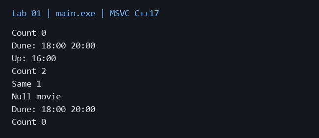

# Лабораторная работа 1

**Дисциплина:** Алгоритмы и структуры данных  
**Институт:** Институт информационных технологий и кибербезопасности  
**Кафедра:** Программная инженерия  
**Студент:** Зорькин Арсений Станиславович  
**Группа:** ПИЖ-б-о-25-2 (1)  
**Вариант:** 12  
**Уровень:** Продвинутый  
**Тема:** Композиция и агрегация классов. Статические члены

[Титульный лист](title.pdf) · [Код C++](main.cpp) · [Репозиторий](https://github.com/False4041/C) · [Папка работы](https://github.com/False4041/C/tree/main/lab-01)

## Цель работы

Освоить композицию, агрегацию, статические члены и Singleton.

## Задание

Cinema как Singleton, агрегация Movie и композиция Session внутри Movie. Статический счётчик объектов и демонстрация возможностей.

## Как работает программа

Cinema хранит невладеющие указатели на фильмы. Movie владеет сеансами через vector. Локальный статический Cinema создаётся один раз. clear удаляет только связи: фильмы остаются доступны. Счётчик учитывает создание, копирование и уничтожение Movie.

## Сложность

total, instance: O(1); add фильма: O(m) из-за проверки дубликатов; add сеанса: амортизированно O(1); print: O(m+s); clear: O(m). Память O(m+s).

## Запуск

Один файл `main.cpp`, стандарт C++17. [Команды сборки](../README.md#сборка).

Без ввода: запустите программу для демонстрации.

## Результат

[Фактический вывод](output.txt) демонстрационного запуска; ниже изображение этого вывода.

## Особенности

Фильмы должны жить дольше ссылок на них в Cinema. Перед их уничтожением вызывается clear. Null-указатель отклоняется.

## Проверка

Сборка MSVC /W4 без предупреждений. Проверены демонстрационный запуск и граничные случаи. [Подробности проверки](../CHECKS.md).

## Вывод

Реализован вариант 12. Cinema хранит невладеющие указатели на фильмы. Результаты демонстрации приведены выше.

## Контрольные вопросы

Ответы на вопросы методички

**1. Что такое композиция? Приведите пример.**

Композиция означает владение частью: Movie содержит Session и определяет их время жизни.

**2. Что такое агрегация? Чем она отличается от композиции?**

Агрегация связывает независимые объекты. Cinema ссылается на Movie, но не удаляет фильмы.

**3. Как реализовать композицию в C++? Приведите пример кода.**

Часть можно хранить полем или во владеющем контейнере: vector<Session> sessions.

**4. Как реализовать агрегацию в C++? Приведите пример кода.**

Используют невладеющую ссылку или указатель: vector<Movie*> movies. Владелец обеспечивает срок жизни фильмов.

**5. В чём разница между временем жизни частей при композиции и агрегации?**

Компоненты уничтожаются вместе с владельцем; агрегированные объекты могут пережить связь с ним.

**6. Что такое статическое поле класса? Чем оно отличается от обычного поля?**

Статическое поле одно на класс, обычное поле находится в каждом объекте.

**7. Как объявить и определить статическое поле? Где оно хранится?**

В классе объявляется static int count, вне класса — int Movie::count=0. Оно имеет статическое время хранения.

**8. Что такое статический метод? Можно ли из него обратиться к нестатическим полям?**

Статический метод вызывается без объекта. Для доступа к обычным полям ему требуется явно переданный объект.

**9. Для чего используются статические счётчики объектов?**

Счётчик показывает число живых объектов; конструкторы увеличивают его, деструктор уменьшает.

**10. Что такое паттерн «Одиночка» (Singleton)? Для чего он нужен?**

Singleton ограничивает создание класса одним экземпляром. Здесь общий экземпляр Cinema возвращает instance().

**11. Как запретить создание копий объекта (конструктор копирования)?**

Копирующий конструктор и присваивание объявляют =delete.

**12. В каком порядке вызываются конструкторы и деструкторы при композиции?**

Сначала создаются поля в порядке объявления, затем тело конструктора. После тела деструктора поля разрушаются в обратном порядке.

**13. Можно ли изменить статическое поле из обычного метода?**

Да. Статическое поле доступно обычным методам и конструкторам класса.

**14. Почему статические поля нужно определять вне класса?**

Объявление обычно не выделяет отдельное определение хранилища. В C++17 inline static можно определить непосредственно в классе.

**15. В каких случаях стоит использовать композицию, а в каких - агрегацию?**

Композицию выбирают при владении и общем сроке жизни, агрегацию — когда объекты управляются независимо.

