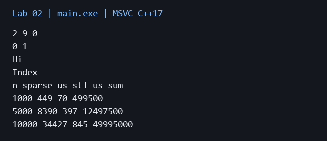
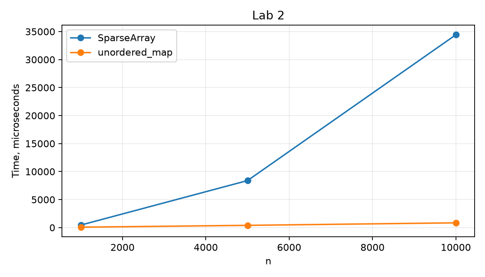

# Лабораторная работа 2

**Дисциплина:** Алгоритмы и структуры данных  
**Институт:** Институт информационных технологий и кибербезопасности  
**Кафедра:** Программная инженерия  
**Студент:** Зорькин Арсений Станиславович  
**Группа:** ПИЖ-б-о-25-2 (1)  
**Вариант:** 12  
**Уровень:** Продвинутый  
**Тема:** Анализ сложности алгоритмов. Шаблоны классов

[Титульный лист](title.pdf) · [Код C++](main.cpp) · [Репозиторий](https://github.com/False4041/C) · [Папка работы](https://github.com/False4041/C/tree/main/lab-02)

## Цель работы

Реализовать шаблонный контейнер и сравнить его сложность с аналогом STL.

## Задание

SparseArray<T>: set, get, remove, size. Анализ каждой операции и экспериментальное сравнение с STL.

## Как работает программа

Хранятся пары «индекс, значение». Отсутствующий индекс возвращает T{}. Повторный set заменяет значение. remove переставляет последний элемент на место удаляемого. Аналог STL — unordered_map<int,int>, операции записи и чтения одинаковы.

## Сложность

Для k сохранённых позиций set/get/remove O(k), size O(1), память O(k). У unordered_map среднее время O(1), худшее O(k). Серия n вставок и чтений здесь O(n²), у STL в среднем O(n).

## Запуск

Один файл `main.cpp`, стандарт C++17. [Команды сборки](../README.md#сборка).

Без ввода: запустите программу для демонстрации.

## Результат

[Фактический вывод](output.txt) демонстрационного запуска; ниже изображение этого вывода.

## Измерения

| n | sparse_us | stl_us | sum |
| --- | --- | --- | --- |
| 1000 | 449 | 70 | 499500 |
| 5000 | 8390 | 397 | 12497500 |
| 10000 | 34427 | 845 | 49995000 |

Один запуск: Windows x64, MSVC 19.44, C++17, /O2. Время зависит от ПК и нагрузки; 0 означает меньше одной микросекунды. [Данные CSV](timing.csv).

## Особенности

Индексы неотрицательны. size — количество сохранённых позиций. Нулевые значения тоже сохраняются. Показаны int и string.

## Проверка

Сборка MSVC /W4 без предупреждений. Проверены демонстрационный запуск и граничные случаи. [Подробности проверки](../CHECKS.md).

## Вывод

Реализован вариант 12. Хранятся пары «индекс, значение». Результаты демонстрации приведены выше.

## Контрольные вопросы

Ответы на вопросы методички

**1. Что такое О-нотация (Big O) и зачем она нужна?**

Big O описывает асимптотическую верхнюю границу роста затрат, позволяя сравнивать алгоритмы независимо от конкретного ПК.

**2. Какая сложность у доступа к элементу массива по индексу? Почему?**

O(1): адрес вычисляется по начальному адресу, индексу и размеру элемента.

**3. Какая сложность у бинарного поиска? Почему?**

O(log n): каждый шаг уменьшает оставшийся интервал примерно вдвое.

**4. Что означает сложность O(n log n)? Приведите пример алгоритма.**

O(n log n) — линейная работа на логарифмическом числе уровней, например mergesort.

**5. Что такое амортизированный анализ? Приведите пример.**

Амортизация усредняет стоимость по последовательности операций. Удвоение vector даёт push_back амортизированно O(1).

**6. Какая сложность у двух вложенных циклов по n итераций каждый?**

O(n²), если тело внутреннего цикла выполняется за постоянное время.

**7. Какая сложность у рекурсивного вычисления чисел Фибоначчи?**

Наивный Фибоначчи экспоненциален из-за повторных одинаковых подзадач: O(φⁿ).

**8. Что такое шаблоны функций? Как их объявить и использовать?**

Шаблон задаёт семейство функций: template<class T> T twice(T x){return x+x;}. Тип выводится из аргумента.

**9. Что такое шаблоны классов? Как их объявить и использовать?**

Шаблон класса задаёт семейство типов: SparseArray<int> и SparseArray<string> используют одну реализацию.

**10. В чём преимущество шаблонов перед перегрузкой функций?**

Не требуется дублировать один алгоритм для каждого типа; ошибки типов проверяются при компиляции.

**11. Как указать, что шаблонный параметр - тип?**

Ключевым словом typename или class в списке параметров шаблона.

**12. Можно ли создать шаблон с несколькими параметрами типов?**

Да, например template<class K,class V> для словаря.

**13. Как провести экспериментальное измерение времени выполнения?**

Измеряют steady_clock до и после работы, затем вычисляют разность; подготовку данных выносят за измеряемый участок.

**14. Почему при измерении времени нужно выполнять операцию многократно?**

Повторы уменьшают влияние разрешения часов и случайного шума. В этой работе приведены времена целых серий операций.

**15. Что важнее: сложность алгоритма или константа?**

На больших данных обычно важен рост сложности, на малых — константы. Поэтому нужны и оценка, и измерения.

