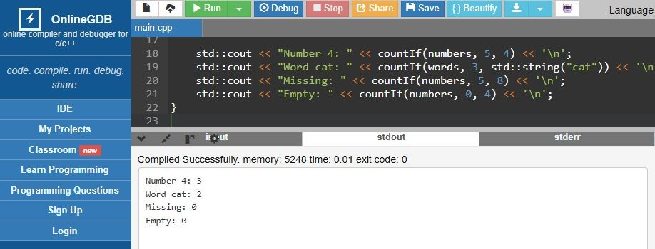

# Лабораторная работа 2

**Дисциплина:** Алгоритмы и структуры данных  
**Институт:** Институт информационных технологий и кибербезопасности  
**Кафедра:** Программная инженерия  
**Студент:** Зорькин Арсений Станиславович  
**Группа:** ПИЖ-б-о-25-2 (1)  
**Вариант:** 12  
**Уровень:** Базовый  
**Тема:** Анализ сложности алгоритмов. Шаблоны классов

[Титульный лист](title.pdf) · [Код C++](main.cpp) · [Репозиторий](https://github.com/False4041/C) · [Папка работы](https://github.com/False4041/C/tree/main/lab-02)

## Цель работы

Научиться оценивать сложность алгоритмов и писать шаблонные функции.

## Задание

Реализовать countIf для подсчёта элементов массива, равных заданному значению. Обосновать сложность фрагментов кода.

## Как работает программа

Функция проходит массив один раз, сравнивает каждый элемент со значением через == и увеличивает счётчик при совпадении. Одна реализация используется для чисел и строк.

## Сложность

countIf выполняет n сравнений и использует O(1) дополнительной памяти. Для целых чисел время O(n). При сравнении строк нужно учитывать их длину.

### Анализ фрагментов

Для разбора взяты примеры из методички (стр. 3).

| Фрагмент | Сложность | Обоснование |
| --- | --- | --- |
| getFirst | O(1) | Читает один элемент. |
| sum | O(n) | Обрабатывает каждый элемент один раз. |
| bubbleSort | O(n²) | Два вложенных цикла выполняют порядка n² сравнений. |
| binarySearch | O(log n) | После шага остаётся примерно половина интервала. |

## Запуск

Один файл main.cpp, стандарт C++17. [Команды сборки](../README.md#сборка).

Демонстрация запускается без ввода.

## Результат

[Текст вывода](output.txt) и скриншот запуска в [OnlineGDB](https://www.onlinegdb.com/online_c++_compiler) в режиме C++17.

## Вывод

Шаблон countIf подсчитывает совпадения в массивах разных типов. Для отсутствующего значения и пустого диапазона результат равен 0.

## Контрольные вопросы

Ответы на вопросы методички

**1. Что такое О-нотация (Big O) и зачем она нужна?**

Big O описывает асимптотическую верхнюю границу роста затрат, позволяя сравнивать алгоритмы независимо от конкретного ПК.

**2. Какая сложность у доступа к элементу массива по индексу? Почему?**

O(1): адрес вычисляется по начальному адресу, индексу и размеру элемента.

**3. Какая сложность у бинарного поиска? Почему?**

O(log n): каждый шаг уменьшает оставшийся интервал примерно вдвое.

**4. Что означает сложность O(n log n)? Приведите пример алгоритма.**

O(n log n) — линейная работа на логарифмическом числе уровней, например mergesort.

**5. Что такое амортизированный анализ? Приведите пример.**

Амортизация усредняет стоимость по последовательности операций. Удвоение vector даёт push_back амортизированно O(1).

**6. Какая сложность у двух вложенных циклов по n итераций каждый?**

O(n²), если тело внутреннего цикла выполняется за постоянное время.

**7. Какая сложность у рекурсивного вычисления чисел Фибоначчи?**

Наивный Фибоначчи экспоненциален из-за повторных одинаковых подзадач: O(φⁿ).

**8. Что такое шаблоны функций? Как их объявить и использовать?**

Шаблон задаёт семейство функций: template<class T> T twice(T x){return x+x;}. Тип выводится из аргумента.

**9. Что такое шаблоны классов? Как их объявить и использовать?**

Шаблон класса задаёт семейство типов: Например, Vector<int> и Vector<std::string> используют один шаблон.

**10. В чём преимущество шаблонов перед перегрузкой функций?**

Не требуется дублировать один алгоритм для каждого типа; ошибки типов проверяются при компиляции.

**11. Как указать, что шаблонный параметр - тип?**

Ключевым словом typename или class в списке параметров шаблона.

**12. Можно ли создать шаблон с несколькими параметрами типов?**

Да, например template<class K,class V> для словаря.

**13. Как провести экспериментальное измерение времени выполнения?**

Измеряют steady_clock до и после работы, затем вычисляют разность; подготовку данных выносят за измеряемый участок.

**14. Почему при измерении времени нужно выполнять операцию многократно?**

Повторы уменьшают влияние разрешения часов и случайного шума. В этой работе приведены времена целых серий операций.

**15. Что важнее: сложность алгоритма или константа?**

На больших данных обычно важен рост сложности, на малых — константы. Поэтому нужны и оценка, и измерения.

