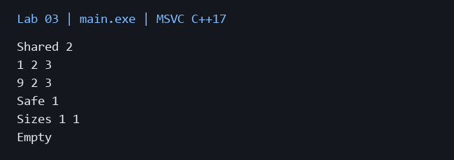

# Лабораторная работа 3

**Дисциплина:** Алгоритмы и структуры данных  
**Институт:** Институт информационных технологий и кибербезопасности  
**Кафедра:** Программная инженерия  
**Студент:** Зорькин Арсений Станиславович  
**Группа:** ПИЖ-б-о-25-2 (1)  
**Вариант:** 12  
**Уровень:** Продвинутый  
**Тема:** Реализация динамического массива (аналог vector). Итераторы

[Титульный лист](title.pdf) · [Код C++](main.cpp) · [Репозиторий](https://github.com/False4041/C) · [Папка работы](https://github.com/False4041/C/tree/main/lab-03)

## Цель работы

Реализовать динамический массив с правилом пяти, итераторами и copy-on-write.

## Задание

Vector<T>: копирование, перемещение, begin/end, расширение буфера и ленивое копирование.

## Как работает программа

Data содержит размер, ёмкость и массив unique_ptr<T[]>. Копии используют shared_ptr<Data>. При изменении общий буфер копируется. Если уже выдана изменяемая ссылка или итератор, последующая копия сразу независима, чтобы старая ссылка не меняла её.

## Сложность

size/capacity/const operator[] O(1). Копирование обычно O(1), после выдачи изменяемой ссылки O(capacity). Перемещение O(1). push_back амортизированно O(1) для собственного буфера; отделение COW или рост O(capacity). pop_back O(1), при COW O(capacity). erase O(n), при COW O(capacity); reserve O(new capacity). const begin/end O(1), изменяемые begin/end при COW O(capacity). Память O(capacity).

## Запуск

Один файл `main.cpp`, стандарт C++17. [Команды сборки](../README.md#сборка).

Без ввода: запустите программу для демонстрации.

## Результат

[Фактический вывод](output.txt) демонстрационного запуска; ниже изображение этого вывода.

## Особенности

T должен иметь конструктор по умолчанию и поддерживать копирование/присваивание. Указатели действуют до изменения буфера. Перемещённый объект допускает повторное заполнение. Самоприсваивание безопасно.

## Проверка

Сборка MSVC /W4 без предупреждений. Проверены демонстрационный запуск и граничные случаи. [Подробности проверки](../CHECKS.md).

## Вывод

Реализован вариант 12. Data содержит размер, ёмкость и массив unique_ptr<T[]>. Результаты демонстрации приведены выше.

## Контрольные вопросы

Ответы на вопросы методички

**1. Почему динамический массив называется «динамическим»?**

Размер хранилища выбирается и меняется во время выполнения.

**2. Что такое ёмкость (capacity ) и чем она отличается от размера (size)?**

size — число элементов, capacity — число выделенных ячеек. Capacity не меньше size.

**3. Почему при расширении массива ёмкость удваивается, а не увеличивается на фиксированное число?**

Геометрический рост ограничивает суммарные копирования линейной величиной; фиксированный шаг даёт квадратичную сумму.

**4. Какова амортизированная сложность операции push_back? Почему?**

Амортизированно O(1) для собственного буфера: редкие расширения распределяются между вставками. COW добавляет копирование при отделении.

**5. Что такое «правило трёх»? Когда оно применяется?**

При ручном владении ресурсом согласованно определяют деструктор, копирующий конструктор и копирующее присваивание.

**6. Что такое «правило пяти»? Чем оно отличается от «правила трёх»?**

Правило пяти добавляет конструктор перемещения и перемещающее присваивание.

**7. В чём разница между конструктором копирования и оператором присваивания?**

Конструктор создаёт новый объект из существующего; присваивание заменяет состояние уже созданного.

**8. Зачем нужна проверка if (this != &other) в операторе присваивания?**

Она предотвращает уничтожение ресурса, который одновременно служит источником присваивания самому себе.

**9. Что такое итератор? Как он связан с указателем?**

Итератор обозначает позицию и поддерживает переход/доступ. Указатель на элемент массива является простым итератором.

**10. Зачем нужны методы begin() и end()?**

begin указывает на первый элемент, end — за последний; диапазон имеет вид [begin,end).

**11. Как реализовать range-based for для своего контейнера?**

Нужны begin/end и операции итератора *, ++, !=. В программе используются указатели.

**12. Что такое «глубокое копирование»? Чем оно отличается от «поверхностного»?**

Глубокая копия создаёт собственные данные; поверхностная копирует адреса. COW безопасно разделяет владение до изменения.

**13. Что такое семантика перемещения и зачем она нужна?**

Перемещение передаёт владение буфером без копирования элементов.

**14. Почему конструктор перемещения помечается noexcept?**

noexcept сообщает контейнерам, что перенос безопасен без отката через копирование.

**15. Как правильно освобождать память в деструкторе?**

new[] сочетается с delete[]. В данном решении массив освобождается unique_ptr, общий Data — shared_ptr.

