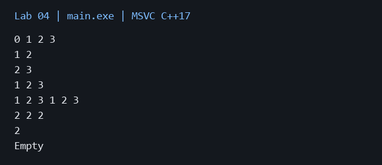

# Лабораторная работа 4

**Дисциплина:** Алгоритмы и структуры данных  
**Институт:** Институт информационных технологий и кибербезопасности  
**Кафедра:** Программная инженерия  
**Студент:** Зорькин Арсений Станиславович  
**Группа:** ПИЖ-б-о-25-2 (1)  
**Вариант:** 12  
**Уровень:** Продвинутый  
**Тема:** Односвязный и двусвязный списки

[Титульный лист](title.pdf) · [Код C++](main.cpp) · [Репозиторий](https://github.com/False4041/C) · [Папка работы](https://github.com/False4041/C/tree/main/lab-04)

## Цель работы

Изучить односвязный, двусвязный и кольцевой списки.

## Задание

SinglyLinkedList и DoublyLinkedList с основными операциями. Кольцевой список на основе двусвязного.

## Как работает программа

У узлов хранятся next либо next и prev. Параметр circular замыкает хвост и голову. Обход кольца ограничивается числом узлов. Копирование создаёт независимые узлы; деструктор освобождает их.

## Сложность

size/empty/push_front/pop_front/push_back O(1). find/at/insert/erase по индексу и pop_back O(n) в данной реализации. Двусвязный pop_back также O(n), поскольку erase ищет узел от головы. clear/копирование/print O(n); память O(n).

## Запуск

Один файл `main.cpp`, стандарт C++17. [Команды сборки](../README.md#сборка).

Без ввода: запустите программу для демонстрации.

## Результат

[Фактический вывод](output.txt) демонстрационного запуска; ниже изображение этого вывода.

## Особенности

Проверены пустой список, один узел, удаление головы/хвоста, копирование и два круга. Некорректный индекс вызывает исключение.

## Проверка

Сборка MSVC /W4 без предупреждений. Проверены демонстрационный запуск и граничные случаи. [Подробности проверки](../CHECKS.md).

## Вывод

Реализован вариант 12. У узлов хранятся next либо next и prev. Результаты демонстрации приведены выше.

## Контрольные вопросы

Ответы на вопросы методички

**1. Чем связный список отличается от динамического массива?**

Массив хранит непрерывные элементы и даёт O(1) по индексу; список состоит из отдельных узлов со связями.

**2. Какие операции в односвязном списке выполняются за O(1)?**

Вставка/удаление головы и добавление хвоста при наличии tail выполняются за O(1).

**3. Почему удаление из конца односвязного списка требует O(n) времени?**

Нужно найти предыдущий узел, потому что обратной связи нет.

**4. Какие преимущества даёт хранение указателя tail в односвязном списке?**

tail позволяет добавлять в конец за O(1), не проходя список.

**5. Чем двусвязный список отличается от односвязного?**

Двусвязный узел содержит указатели и на следующий, и на предыдущий узел.

**6. Какие операции в двусвязном списке выполняются быстрее, чем в односвязном?**

При известном узле двусвязный список позволяет удалить его и перейти назад за O(1). В нашем API поиск по индексу всё равно O(n).

**7. Что такое «голова» (head) и «хвост» (tail) списка?**

head — первый узел, tail — последний. У пустого списка оба отсутствуют.

**8. Как удалить узел из середины односвязного списка?**

Найти предшественника, перенаправить next на следующий после удаляемого и освободить узел.

**9. Как удалить узел из середины двусвязного списка? Почему это проще?**

Связи соседей доступны через prev/next, поэтому не нужно искать предшественника.

**10. Что произойдёт, если забыть обновить tail при удалении?**

tail станет устаревшим указателем; следующая вставка может обратиться к освобождённой памяти.

**11. Как реализовать реверс односвязного списка?**

Поочерёдно перенаправить next на предыдущий узел, затем обменять голову и хвост.

**12. Как обнаружить цикл в связном списке?**

Алгоритмом Флойда: медленный указатель делает шаг, быстрый — два; встреча означает цикл.

**13. В каких случаях стоит использовать список вместо массива?**

Когда важны частые вставки/удаления при известных позициях и не нужен быстрый индексный доступ.

**14. Какая дополнительная память требуется для каждого узла списка?**

Один указатель для односвязного, два для двусвязного, плюс выравнивание и накладные расходы выделения.

**15. Почему доступ по индексу в списке имеет сложность O(n)?**

Чтобы попасть к индексу, приходится пройти предшествующие узлы.

