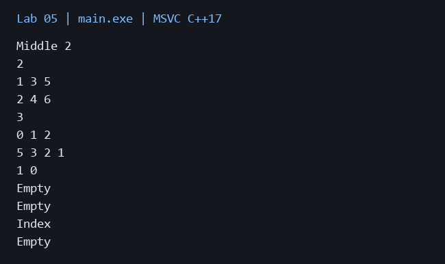

# Лабораторная работа 5

**Дисциплина:** Алгоритмы и структуры данных  
**Институт:** Институт информационных технологий и кибербезопасности  
**Кафедра:** Программная инженерия  
**Студент:** Зорькин Арсений Станиславович  
**Группа:** ПИЖ-б-о-25-2 (1)  
**Вариант:** 12  
**Уровень:** Полный вариант: в методичке нет разделения по уровням  
**Тема:** Стек, очередь, дек, приоритетная очередь

[Титульный лист](title.pdf) · [Код C++](main.cpp) · [Репозиторий](https://github.com/False4041/C) · [Папка работы](https://github.com/False4041/C/tree/main/lab-05)

## Цель работы

Реализовать стек, очередь, дек и бинарную кучу.

## Задание

Стек: getMiddle. Очередь: разделение по чётным и нечётным позициям. Дек: insertAt(index). Приоритетная очередь: проверка свойства двоичной кучи.

## Как работает программа

Стек и дек используют vector, очередь — связанные узлы, приоритетная очередь — max-heap. Позиции очереди считаются с 1. split переносит элементы с сохранением порядка. В чётном стеке выбирается нижний из двух средних элементов.

## Сложность

Стек: push амортизированно O(1), остальные операции O(1). Очередь: enqueue/dequeue/front O(1), split O(n). Дек: push_back амортизированно O(1), pop_back/front/back O(1), push_front/pop_front/insertAt O(n). Куча: push/pop O(log n), top O(1), isHeap O(n). isEmpty везде O(1), память O(n).

## Запуск

Один файл `main.cpp`, стандарт C++17. [Команды сборки](../README.md#сборка).

Без ввода: запустите программу для демонстрации.

## Результат

[Фактический вывод](output.txt) демонстрационного запуска; ниже изображение этого вывода.

## Особенности

Удаление из пустых структур проверяется. split запрещает совпадение источника и выходных очередей.

## Проверка

Сборка MSVC /W4 без предупреждений. Проверены демонстрационный запуск и граничные случаи. [Подробности проверки](../CHECKS.md).

## Вывод

Реализован вариант 12. Стек и дек используют vector, очередь — связанные узлы, приоритетная очередь — max-heap. Результаты демонстрации приведены выше.

## Контрольные вопросы

Ответы на вопросы методички

**1. В чём заключается принцип работы стека (LIFO)?**

LIFO: последним добавлен — первым извлечён.

**2. В чём заключается принцип работы очереди (FIFO)?**

FIFO: первым добавлен — первым извлечён.

**3. Чем дек отличается от обычной очереди?**

Дек поддерживает добавление и удаление с обоих концов.

**4. Что такое приоритетная очередь? Где она применяется?**

Приоритетная очередь выдаёт элемент с наибольшим или наименьшим приоритетом; применяется в планировщиках и Дейкстре.

**5. Как реализовать стек на основе динамического массива?**

Хранить элементы в массиве и изменять конец через push_back/pop_back.

**6. Как реализовать очередь на основе кольцевого буфера?**

Поддерживать индексы головы/хвоста по модулю ёмкости и количество элементов.

**7. Почему приоритетную очередь обычно реализуют на куче?**

Куча позволяет получить вершину за O(1), а вставить/извлечь за O(log n), не сортируя весь массив.

**8. Какова сложность операций push и pop в стеке?**

Для массива push амортизированно O(1), pop O(1); расширение отдельной вставки O(n).

**9. Какова сложность операций enqueue и dequeue в очереди?**

У очереди на связанных узлах или кольцевом буфере обе операции O(1), без учёта роста буфера.

**10. Какова сложность операций в приоритетной очереди? Почему?**

push/pop O(log n), потому что элемент проходит высоту бинарной кучи; top O(1).

**11. Как проверить правильность расстановки скобок с помощью стека?**

Открывающие скобки класть в стек; закрывающую сопоставлять вершине. В конце стек должен быть пуст.

**12. Как реализовать очередь на двух стеках? Какова сложность?**

Вставлять в первый стек. При извлечении, если второй пуст, перенести туда все элементы первого. Операция амортизированно O(1).

**13. Как реализовать дек на основе двусвязного списка?**

Хранить head/tail и связи prev/next; операции с обоих концов O(1).

**14. Как реализовать дек на основе кольцевого буфера?**

Двигать head и tail по модулю ёмкости; контролировать пустоту и заполнение.

**15. Как реализовать стек с поддержкой получения минимума за O(1)?**

В дополнительном стеке хранить текущие минимумы, обновляя его синхронно с основным.

