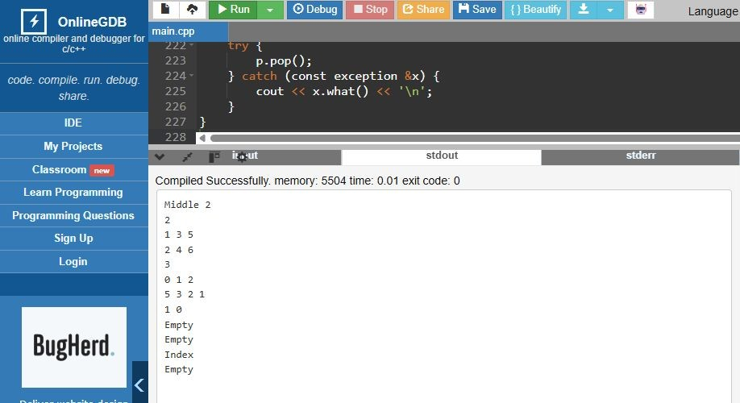

# Лабораторная работа 5

**Дисциплина:** Алгоритмы и структуры данных  
**Институт:** Институт информационных технологий и кибербезопасности  
**Кафедра:** Программная инженерия  
**Студент:** Зорькин Арсений Станиславович  
**Группа:** ПИЖ-б-о-25-2 (1)  
**Вариант:** 12  
**Уровень:** Базовый по объёму (в методичке уровни не выделены)  
**Тема:** Стек, очередь, дек, приоритетная очередь

[Титульный лист](title.pdf) · [Код C++](main.cpp) · [Репозиторий](https://github.com/False4041/C) · [Папка работы](https://github.com/False4041/C/tree/main/lab-05)

## Цель работы

Изучить стек, очередь, дек и приоритетную очередь и реализовать их основные операции.

## Задание

Найти средний элемент стека, разделить очередь по нечётным и чётным позициям, добавить вставку по индексу в дек и проверку массива на свойства max-heap.

## Как работает программа

Стек хранит элементы в vector. При чётной длине getMiddle берёт более ранний из двух средних элементов. Очередь на связанных узлах переносит элементы в две очереди по позициям, начиная с первой. Дек хранит элементы в vector и сдвигает их при вставке по индексу. Приоритетная очередь поддерживает max-heap обменами элементов. isHeap проверяет, что значение родителя не меньше значения каждого ребёнка.

## Сложность

У стека чтение вершины и середины занимает O(1), вставка — амортизированно O(1). У очереди добавление и удаление занимают O(1), разделение — O(n). Вставка по индексу и удаление с начала дека занимают O(n) в худшем случае. В куче подъём и спуск занимают O(log n), с учётом роста буфера вставка имеет амортизированную оценку O(log n). isHeap занимает O(n).

## Запуск

Один файл main.cpp, стандарт C++17. [Команды сборки](../README.md#сборка).

Демонстрация запускается без ввода.

## Результат

[Текст вывода](output.txt) и скриншот запуска в [OnlineGDB](https://www.onlinegdb.com/online_c++_compiler) в режиме C++17.

## Вывод

Программа показывает порядок элементов после разделения очереди, вставки в дек и извлечения из кучи.

## Контрольные вопросы

Ответы на вопросы методички

**1. В чём заключается принцип работы стека (LIFO)?**

LIFO: последним добавлен — первым извлечён.

**2. В чём заключается принцип работы очереди (FIFO)?**

FIFO: первым добавлен — первым извлечён.

**3. Чем дек отличается от обычной очереди?**

Дек поддерживает добавление и удаление с обоих концов.

**4. Что такое приоритетная очередь? Где она применяется?**

Приоритетная очередь выдаёт элемент с наибольшим или наименьшим приоритетом; применяется в планировщиках и Дейкстре.

**5. Как реализовать стек на основе динамического массива?**

Хранить элементы в массиве и изменять конец через push_back/pop_back.

**6. Как реализовать очередь на основе кольцевого буфера?**

Поддерживать индексы головы/хвоста по модулю ёмкости и количество элементов.

**7. Почему приоритетную очередь обычно реализуют на куче?**

Куча позволяет получить вершину за O(1), а вставить/извлечь за O(log n), не сортируя весь массив.

**8. Какова сложность операций push и pop в стеке?**

Для массива push амортизированно O(1), pop O(1); расширение отдельной вставки O(n).

**9. Какова сложность операций enqueue и dequeue в очереди?**

У очереди на связанных узлах или кольцевом буфере обе операции O(1), без учёта роста буфера.

**10. Какова сложность операций в приоритетной очереди? Почему?**

push/pop O(log n), потому что элемент проходит высоту бинарной кучи; top O(1).

**11. Как проверить правильность расстановки скобок с помощью стека?**

Открывающие скобки класть в стек; закрывающую сопоставлять вершине. В конце стек должен быть пуст.

**12. Как реализовать очередь на двух стеках? Какова сложность?**

Вставлять в первый стек. При извлечении, если второй пуст, перенести туда все элементы первого. Операция амортизированно O(1).

**13. Как реализовать дек на основе двусвязного списка?**

Хранить head/tail и связи prev/next; операции с обоих концов O(1).

**14. Как реализовать дек на основе кольцевого буфера?**

Двигать head и tail по модулю ёмкости; контролировать пустоту и заполнение.

**15. Как реализовать стек с поддержкой получения минимума за O(1)?**

В дополнительном стеке хранить текущие минимумы, обновляя его синхронно с основным.

