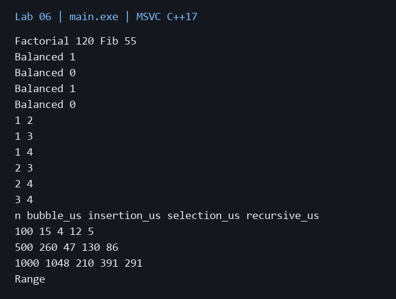
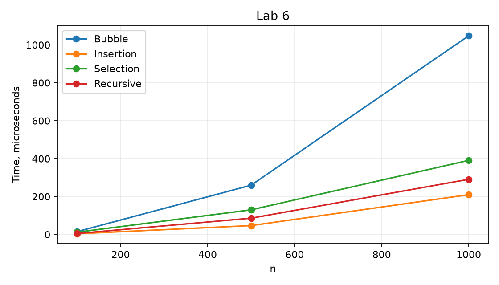

# Лабораторная работа 6

**Дисциплина:** Алгоритмы и структуры данных  
**Институт:** Институт информационных технологий и кибербезопасности  
**Кафедра:** Программная инженерия  
**Студент:** Зорькин Арсений Станиславович  
**Группа:** ПИЖ-б-о-25-2 (1)  
**Вариант:** 12  
**Уровень:** Полный вариант: в методичке нет разделения по уровням  
**Тема:** Рекурсивные алгоритмы. Простые сортировки

[Титульный лист](title.pdf) · [Код C++](main.cpp) · [Репозиторий](https://github.com/False4041/C) · [Папка работы](https://github.com/False4041/C/tree/main/lab-06)

## Цель работы

Освоить рекурсию и сравнить простые сортировки.

## Задание

Факториал, Фибоначчи, проверка скобок, генерация комбинаций. Сортировки пузырьком, вставками, выбором и рекурсивные вставки.

## Как работает программа

Проверка скобок запоминает ожидаемый закрывающий символ. Генератор перечисляет сочетания k элементов из 1..n без повторений; пример n=4, k=2. Сортировки работают на одинаковых случайных массивах и сверяются со sort.

## Сложность

Факториал O(n), стек O(n). Фибоначчи O(φⁿ), стек O(n). Скобки O(n), стек O(n). Вывод сочетаний O(k·C(n,k)). Пузырёк/вставки O(n²), лучший случай O(n); выбор O(n²). Рекурсивные вставки O(n²), стек O(n); остальные сортировки используют O(1) дополнительной памяти.

## Запуск

Один файл `main.cpp`, стандарт C++17. [Команды сборки](../README.md#сборка).

Без ввода: запустите программу для демонстрации.

## Результат

[Фактический вывод](output.txt) демонстрационного запуска; ниже изображение этого вывода.

## Измерения

| n | bubble_us | insertion_us | selection_us | recursive_us |
| --- | --- | --- | --- | --- |
| 100 | 15 | 4 | 12 | 5 |
| 500 | 260 | 47 | 130 | 86 |
| 1000 | 1048 | 210 | 391 | 291 |

Один запуск: Windows x64, MSVC 19.44, C++17, /O2. Время зависит от ПК и нагрузки; 0 означает меньше одной микросекунды. [Данные CSV](timing.csv).

## Особенности

Факториал ограничен 0..20 из-за unsigned long long, Фибоначчи 0..40 из-за времени. Комбинации трактуются как сочетания без повторений.

## Проверка

Сборка MSVC /W4 без предупреждений. Проверены демонстрационный запуск и граничные случаи. [Подробности проверки](../CHECKS.md).

## Вывод

Реализован вариант 12. Проверка скобок запоминает ожидаемый закрывающий символ. Результаты демонстрации приведены выше.

## Контрольные вопросы

Ответы на вопросы методички

**1. Что такое рекурсия? Из каких компонентов состоит рекурсивная функция?**

Рекурсия — вызов функции самой собой прямо или косвенно. Нужны базовый случай и шаг к нему.

**2. Что такое базовый случай рекурсии? Почему он важен?**

Это условие завершения; без него рекурсия не остановится и переполнит стек.

**3. Чем отличается прямая рекурсия от косвенной?**

Прямая вызывает себя, косвенная возвращается к себе через другие функции.

**4. Что такое хвостовая рекурсия? В чём её преимущество?**

Хвостовой вызов — последняя операция функции. Он допускает оптимизацию стека, но C++ её не гарантирует.

**5. Какова временная сложность рекурсивного вычисления чисел Фибоначчи? Почему?**

O(φⁿ): два рекурсивных вызова повторно решают одинаковые подзадачи.

**6. Как можно оптимизировать рекурсивное вычисление Фибоначчи?**

Мемоизация или итерация снижают время до O(n); итерации достаточно O(1) дополнительной памяти.

**7. В чём отличие рекурсивной реализации от итеративной?**

Рекурсия использует стек вызовов, итерация управляет состоянием в цикле.

**8. Какова сложность пузырьковой сортировки? Когда она становится O(n)?**

Худшее O(n²); с ранним выходом при отсутствии обменов упорядоченный массив обрабатывается за O(n).

**9. Чем сортировка вставками отличается от сортировки выбором?**

Вставки сдвигают элементы, помещая новый в готовую часть. Выбор каждый раз ищет минимум и меняет его с началом остатка.

**10. Какая из простых сортировок является устойчивой? Что это значит?**

Пузырёк и вставки устойчивы при строгом сравнении: равные элементы сохраняют взаимный порядок. Обычный выбор неустойчив.

**11. Какая из простых сортировок работает лучше на почти отсортированных данных?**

Вставки: число сдвигов близко к числу инверсий, на почти упорядоченных данных оно мало.

**12. Как реализовать пузырьковую сортировку с оптимизацией?**

После каждого прохода проверять, были ли обмены, и уменьшать правую границу.

**13. Что такое рекурсивный поиск с возвратом (backtracking)?**

Backtracking строит частичное решение, исследует ветвь и отменяет выбор перед следующей ветвью.

**14. Как рекурсивно обойти лабиринт?**

Отметить клетку посещённой, рекурсивно перейти в допустимых соседей, обработать достижение выхода.

**15. Какова сложность Ханойских башен? Сколько ходов нужно для перемещения n дисков?**

Нужно 2ⁿ−1 ходов, время O(2ⁿ), глубина O(n).

