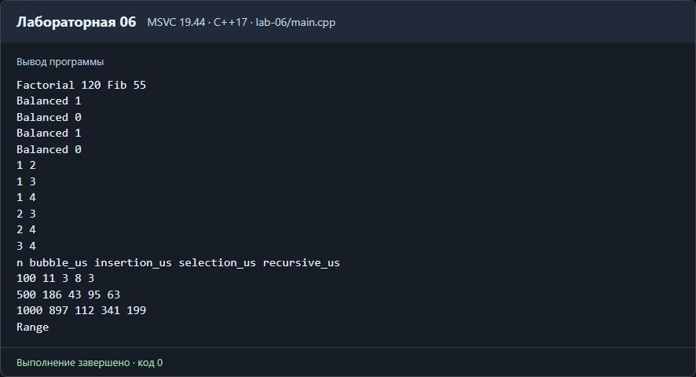
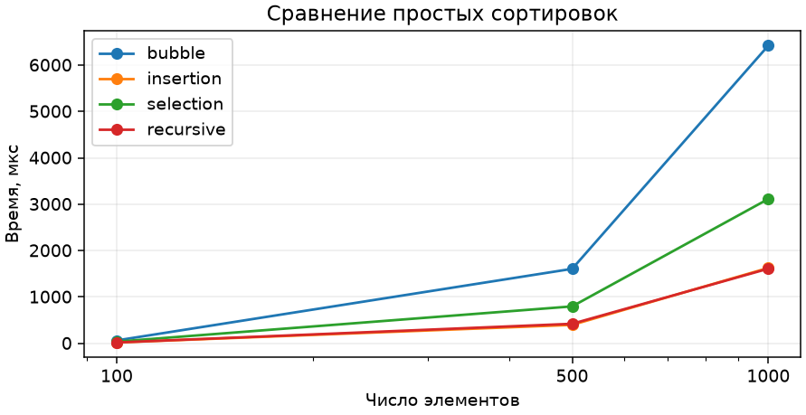

# Лабораторная работа 6

**Дисциплина:** Алгоритмы и структуры данных  
**Институт:** Институт информационных технологий и кибербезопасности  
**Кафедра:** Программная инженерия  
**Студент:** Зорькин Арсений Станиславович  
**Группа:** ПИЖ-б-о-25-2 (1)  
**Вариант:** 12  
**Уровень:** Средний по объёму (в методичке уровни не выделены)  
**Тема:** Рекурсивные алгоритмы. Простые сортировки

[Титульный лист](title.pdf) · [Код C++](main.cpp) · [Репозиторий](https://github.com/False4041/C) · [Папка работы](https://github.com/False4041/C/tree/main/lab-06)

## Цель работы

Разобраться с рекурсией и сравнить простые сортировки на одинаковых данных.

## Задание

Рекурсивно вычислить факториал и число Фибоначчи, проверить скобки и вывести сочетания. Реализовать сортировку пузырьком, вставками, выбором и рекурсивными вставками.

## Как работает программа

Рекурсивные вызовы останавливаются на простейшем случае. При проверке скобок каждый вызов запоминает ожидаемую закрывающую скобку. Сочетания строятся последовательным выбором чисел. Обе сортировки вставками используют один шаг сдвига, а рекурсивная версия сначала сортирует префикс без последнего элемента.

## Сложность

Факториал занимает O(n), простой рекурсивный Фибоначчи — O(φⁿ), проверка скобок — O(n) при глубине стека, равной вложенности. Для вывода сочетаний из n по k нужно O(k · C(n, k)) времени. В худшем случае каждая из четырёх сортировок занимает O(n²), рекурсивные вставки дополнительно используют O(n) памяти стека.

## Запуск

Один файл main.cpp, стандарт C++17. [Команды сборки](../README.md#сборка).

Демонстрация запускается без ввода.

## Результат

[Текст вывода](output.txt) и скриншот запуска в [OnlineGDB](https://www.onlinegdb.com/online_c++_compiler) в режиме C++17.

## Измерения

Каждая сортировка получает копию одного и того же массива. Время в микросекундах, один запуск в OnlineGDB.

| n | bubble_us | insertion_us | selection_us | recursive_us |
| --- | --- | --- | --- | --- |
| 100 | 62 | 17 | 36 | 18 |
| 500 | 1606 | 397 | 796 | 421 |
| 1000 | 6421 | 1626 | 3113 | 1609 |

[Данные CSV](timing.csv)

## Вывод

Сочетания и скобки проверяются на коротких примерах. В замерах на случайных массивах два варианта сортировки вставками показали близкое время.

## Контрольные вопросы

Ответы на вопросы методички

**1. Что такое рекурсия? Из каких компонентов состоит рекурсивная функция?**

Рекурсия — вызов функции самой собой прямо или косвенно. Нужны базовый случай и шаг к нему.

**2. Что такое базовый случай рекурсии? Почему он важен?**

Это условие завершения; без него рекурсия не остановится и переполнит стек.

**3. Чем отличается прямая рекурсия от косвенной?**

Прямая вызывает себя, косвенная возвращается к себе через другие функции.

**4. Что такое хвостовая рекурсия? В чём её преимущество?**

Хвостовой вызов — последняя операция функции. Он допускает оптимизацию стека, но C++ её не гарантирует.

**5. Какова временная сложность рекурсивного вычисления чисел Фибоначчи? Почему?**

O(φⁿ): два рекурсивных вызова повторно решают одинаковые подзадачи.

**6. Как можно оптимизировать рекурсивное вычисление Фибоначчи?**

Мемоизация или итерация снижают время до O(n); итерации достаточно O(1) дополнительной памяти.

**7. В чём отличие рекурсивной реализации от итеративной?**

Рекурсия использует стек вызовов, итерация управляет состоянием в цикле.

**8. Какова сложность пузырьковой сортировки? Когда она становится O(n)?**

Худшее O(n²); с ранним выходом при отсутствии обменов упорядоченный массив обрабатывается за O(n).

**9. Чем сортировка вставками отличается от сортировки выбором?**

Вставки сдвигают элементы, помещая новый в готовую часть. Выбор каждый раз ищет минимум и меняет его с началом остатка.

**10. Какая из простых сортировок является устойчивой? Что это значит?**

Пузырёк и вставки устойчивы при строгом сравнении: равные элементы сохраняют взаимный порядок. Обычный выбор неустойчив.

**11. Какая из простых сортировок работает лучше на почти отсортированных данных?**

Вставки: число сдвигов близко к числу инверсий, на почти упорядоченных данных оно мало.

**12. Как реализовать пузырьковую сортировку с оптимизацией?**

После каждого прохода проверять, были ли обмены, и уменьшать правую границу.

**13. Что такое рекурсивный поиск с возвратом (backtracking)?**

Backtracking строит частичное решение, исследует ветвь и отменяет выбор перед следующей ветвью.

**14. Как рекурсивно обойти лабиринт?**

Отметить клетку посещённой, рекурсивно перейти в допустимых соседей, обработать достижение выхода.

**15. Какова сложность Ханойских башен? Сколько ходов нужно для перемещения n дисков?**

Нужно 2ⁿ−1 ходов, время O(2ⁿ), глубина O(n).

