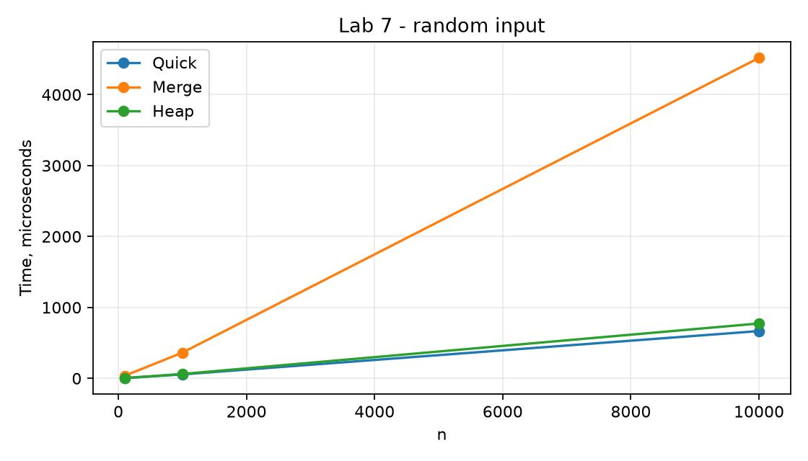

# Лабораторная работа 7

**Дисциплина:** Алгоритмы и структуры данных  
**Институт:** Институт информационных технологий и кибербезопасности  
**Кафедра:** Программная инженерия  
**Студент:** Зорькин Арсений Станиславович  
**Группа:** ПИЖ-б-о-25-2 (1)  
**Вариант:** 12  
**Уровень:** Продвинутый  
**Тема:** Быстрая сортировка, сортировка слиянием, пирамидальная сортировка

[Титульный лист](title.pdf) · [Код C++](main.cpp) · [Репозиторий](https://github.com/False4041/C) · [Папка работы](https://github.com/False4041/C/tree/main/lab-07)

## Цель работы

Сравнить эффективные сортировки и разделить слияние между исполнителями.

## Задание

Quicksort, mergesort, heapsort. Продвинутый вариант 12: сортировка слиянием для распределённых систем.

## Как работает программа

split делит файл, worker независимо сортирует часть, merge объединяет готовые файлы. Обмен файлами позволяет запускать исполнителей на разных компьютерах без сторонних библиотек. Проверка использовала четыре отдельных процесса.

## Сложность

Quicksort: среднее O(n log n), худшее O(n²), стек в среднем O(log n), худшее O(n). Mergesort O(n log n), память O(n). Heapsort O(n log n), память O(1). Разбиение O(n), worker O((n/k) log(n/k)), последовательное слияние k файлов O(nk), память O(n).

## Запуск

Один файл `main.cpp`, стандарт C++17. [Команды сборки](../README.md#сборка).

[Пример ввода](input.txt):

```text
8 3 7 1 5 2 6 4
```

### Разделение между исполнителями

Файл содержит целые числа через пробел. Пример на двух исполнителях:

```text
main.exe split input.txt 2
main.exe worker part0.txt sorted0.txt
main.exe worker part1.txt sorted1.txt
main.exe merge result.txt sorted0.txt sorted1.txt
```

worker можно выполнить на отдельных машинах. Передайте каждому программу своей платформы и его part-файл; верните sorted-файлы для merge.


## Результат

[Фактический вывод](output.txt) демонстрационного запуска; ниже изображение этого вывода.


## Измерения

| n | kind | quick_us | merge_us | heap_us |
| --- | --- | --- | --- | --- |
| 100 | 0 | 4 | 37 | 4 |
| 100 | 1 | 1 | 30 | 4 |
| 100 | 2 | 0 | 30 | 3 |
| 1000 | 0 | 56 | 363 | 62 |
| 1000 | 1 | 5 | 298 | 53 |
| 1000 | 2 | 5 | 312 | 49 |
| 10000 | 0 | 667 | 4518 | 774 |
| 10000 | 1 | 59 | 4414 | 878 |
| 10000 | 2 | 80 | 5804 | 672 |



Один запуск: Windows x64, MSVC 19.44, C++17, /O2. Время зависит от ПК и нагрузки; 0 означает меньше одной микросекунды. [Данные CSV](timing.csv).

## Особенности

Передача файлов исполнителям выполняется вручную. Проверка была локальной, сетевой кластер не разворачивался. Стабильна сортировка слиянием. kind: 0 случайный, 1 возрастающий, 2 убывающий массив.

## Проверка

Сборка MSVC /W4 без предупреждений. Проверены демонстрационный запуск и граничные случаи. [Подробности проверки](../CHECKS.md).

## Вывод

Реализован вариант 12. split делит файл, worker независимо сортирует часть, merge объединяет готовые файлы. Результаты демонстрации приведены выше.

## Контрольные вопросы

<details>
<summary>Ответы на вопросы методички</summary>

**1. Какова сложность быстрой сортировки в лучшем, среднем и худшем случае?**

Лучшее и среднее O(n log n), худшее O(n²).

**2. Когда возникает худший случай для быстрой сортировки?**

Когда опорный элемент систематически делит данные на крайне неравные части.

**3. Как можно улучшить быструю сортировку для защиты от худшего случая?**

Случайный pivot, медиана нескольких элементов, трёхчастное разбиение или переход к heapsort при большой глубине.

**4. Какова сложность сортировки слиянием? Почему она всегда O(n log n)?**

На каждом из O(log n) уровней обрабатывается O(n) элементов, итого O(n log n).

**5. Какие преимущества и недостатки имеет сортировка слиянием перед быстрой?**

Mergesort стабилен и гарантирует оценку, но обычно требует O(n) дополнительной памяти.

**6. Как работает пирамидальная сортировка? Какова её сложность?**

Строится max-heap, вершина переносится в конец, затем куча восстанавливается. Время O(n log n).

**7. Какая из трёх сортировок устойчивая? Почему?**

Mergesort устойчив, если при равенстве сначала брать левый элемент; так сделано в combine.

**8. Какая из трёх сортировок требует дополнительной памяти? Сколько?**

Mergesort требует O(n) буфера. Quicksort — стек до O(n), обычно O(log n). Heapsort обходится O(1).

**9. Какая из трёх сортировок лучше работает на почти отсортированных данных?**

Универсального победителя нет. В этих реализациях все обычно сохраняют O(n log n) на таких данных; выбирать следует по замерам и ограничениям.

**10. Зачем в пирамидальной сортировке сначала строится куча?**

Куча позволяет быстро извлекать максимум и размещать его в окончательной позиции.

**11. Что такое «разделяй и властвуй»? Как он применяется в быстрой сортировке и сортировке слиянием?**

Задача делится на части, части решаются и объединяются. Quicksort делит по pivot, mergesort сортирует половины и сливает.

**12. Можно ли реализовать быструю сортировку итеративно (без рекурсии)?**

Да, храня интервалы обработки в собственном стеке.

**13. Почему быстрая сортировка обычно быстрее сортировки слиянием на практике?**

Он обычно хорошо использует кэш и требует меньше дополнительной памяти; результат зависит от реализации и данных.

**14. Когда выгодно использовать пирамидальную сортировку?**

Когда важны гарантированное O(n log n) и малая дополнительная память, а устойчивость не нужна.

**15. Какой алгоритм сортировки вы бы выбрали для встроенных систем с ограниченной памятью?**

Heapsort: O(1) дополнительной памяти и отсутствие рекурсивного стека.

</details>
