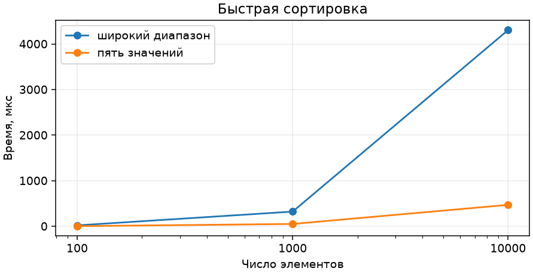

# Лабораторная работа 7

**Дисциплина:** Алгоритмы и структуры данных  
**Институт:** Институт информационных технологий и кибербезопасности  
**Кафедра:** Программная инженерия  
**Студент:** Зорькин Арсений Станиславович  
**Группа:** ПИЖ-б-о-25-2 (1)  
**Вариант:** 12  
**Уровень:** Средний  
**Тема:** Быстрая сортировка, сортировка слиянием, пирамидальная сортировка

[Титульный лист](title.pdf) · [Код C++](main.cpp) · [Репозиторий](https://github.com/False4041/C) · [Папка работы](https://github.com/False4041/C/tree/main/lab-07)

## Цель работы

Освоить быструю сортировку с трёхчастным разбиением и оценить её поведение при повторах.

## Задание

Реализовать быструю сортировку с трёхчастным разбиением для повторяющихся элементов и провести анализ.

## Как работает программа

Опорным берётся значение в середине текущего отрезка. Индексы less, current и greater делят массив на значения меньше, равные и больше опорного. Зона равных значений готова после одного прохода. Рекурсивные вызовы сортируют левую и правую части.

## Сложность

Один проход разбиения занимает O(n). Для случайных данных время в среднем O(n log n), при систематически неравном разбиении — O(n²). Массив одинаковых значений сортируется за O(n). Стек рекурсии занимает в среднем O(log n) и в худшем случае O(n).

## Запуск

Один файл main.cpp, стандарт C++17. [Команды сборки](../README.md#сборка).

Демонстрация запускается без ввода.

## Результат

[Текст вывода](output.txt) и скриншот запуска в [OnlineGDB](https://www.onlinegdb.com/online_c++_compiler) в режиме C++17.

## Измерения

На каждом размере сравниваются массивы со случайными числами из широкого диапазона и из пяти возможных значений. Время в микросекундах, один запуск в OnlineGDB.

| n | random_us | repeats_us |
| --- | --- | --- |
| 100 | 21 | 4 |
| 1000 | 323 | 52 |
| 10000 | 4306 | 471 |

[Данные CSV](timing.csv)

## Вывод

Равные элементы обрабатываются группой. В приведённых замерах массивы с пятью возможными значениями сортировались быстрее.

## Контрольные вопросы

Ответы на вопросы методички

**1. Какова сложность быстрой сортировки в лучшем, среднем и худшем случае?**

Для разных ключей и равномерного разбиения O(n log n). Среднее время O(n log n), худшее O(n²). Трёхчастное разбиение обрабатывает одинаковые ключи за O(n).

**2. Когда возникает худший случай для быстрой сортировки?**

Когда опорный элемент систематически делит данные на крайне неравные части.

**3. Как можно улучшить быструю сортировку для защиты от худшего случая?**

Случайный pivot, медиана нескольких элементов, трёхчастное разбиение или переход к heapsort при большой глубине.

**4. Какова сложность сортировки слиянием? Почему она всегда O(n log n)?**

На каждом из O(log n) уровней обрабатывается O(n) элементов, итого O(n log n).

**5. Какие преимущества и недостатки имеет сортировка слиянием перед быстрой?**

Mergesort стабилен и гарантирует оценку, но обычно требует O(n) дополнительной памяти.

**6. Как работает пирамидальная сортировка? Какова её сложность?**

Строится max-heap, вершина переносится в конец, затем куча восстанавливается. Время O(n log n).

**7. Какая из трёх сортировок устойчивая? Почему?**

Сортировка слиянием устойчива, если при равенстве сначала брать элемент из левой части.

**8. Какая из трёх сортировок требует дополнительной памяти? Сколько?**

Mergesort требует O(n) буфера. Quicksort — стек до O(n), обычно O(log n). Heapsort обходится O(1).

**9. Какая из трёх сортировок лучше работает на почти отсортированных данных?**

Универсального победителя нет. Для быстрой сортировки результат зависит от выбора опорного элемента, а сортировка слиянием и пирамидальная дают оценку O(n log n).

**10. Зачем в пирамидальной сортировке сначала строится куча?**

Куча позволяет быстро извлекать максимум и размещать его в окончательной позиции.

**11. Что такое «разделяй и властвуй»? Как он применяется в быстрой сортировке и сортировке слиянием?**

Задача делится на части, части решаются и объединяются. Quicksort делит по pivot, mergesort сортирует половины и сливает.

**12. Можно ли реализовать быструю сортировку итеративно (без рекурсии)?**

Да, храня интервалы обработки в собственном стеке.

**13. Почему быстрая сортировка обычно быстрее сортировки слиянием на практике?**

Он обычно хорошо использует кэш и требует меньше дополнительной памяти; результат зависит от реализации и данных.

**14. Когда выгодно использовать пирамидальную сортировку?**

Когда важны гарантированное O(n log n) и малая дополнительная память, а устойчивость не нужна.

**15. Какой алгоритм сортировки вы бы выбрали для встроенных систем с ограниченной памятью?**

Heapsort: O(1) дополнительной памяти и отсутствие рекурсивного стека.

