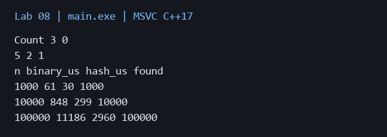
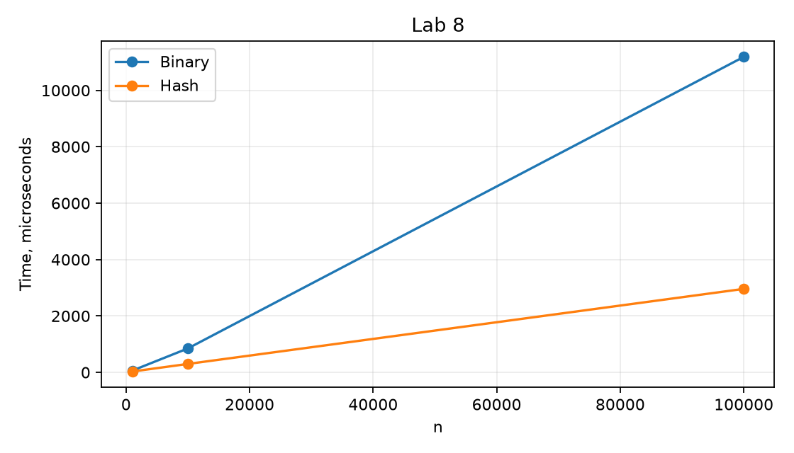

# Лабораторная работа 8

**Дисциплина:** Алгоритмы и структуры данных  
**Институт:** Институт информационных технологий и кибербезопасности  
**Кафедра:** Программная инженерия  
**Студент:** Зорькин Арсений Станиславович  
**Группа:** ПИЖ-б-о-25-2 (1)  
**Вариант:** 12  
**Уровень:** Полный вариант: в методичке нет разделения по уровням  
**Тема:** Двоичный поиск. Хеш-таблицы

[Титульный лист](title.pdf) · [Код C++](main.cpp) · [Репозиторий](https://github.com/False4041/C) · [Папка работы](https://github.com/False4041/C/tree/main/lab-08)

## Цель работы

Изучить двоичный поиск и хеширование.

## Задание

Подсчёт вхождений двоичным поиском. Хеш-таблица «целый ключ → студент» с линейным пробированием. Сравнение времени поиска.

## Как работает программа

Количество равно разности верхней и нижней границ, вычисленных собственным алгоритмом. Ячейка имеет состояния: пустая, занятая, удалённая. Удалённая ячейка сохраняет цепочку поиска. Повторный ключ обновляется.

## Сложность

Поиск/подсчёт в массиве O(log n), дополнительная память O(1). put/get/remove в среднем O(1) при малой загрузке, худшее O(capacity); size O(1). Память O(capacity).

## Запуск

Один файл `main.cpp`, стандарт C++17. [Команды сборки](../README.md#сборка).

Без ввода: запустите программу для демонстрации.

## Результат

[Фактический вывод](output.txt) демонстрационного запуска; ниже изображение этого вывода.

## Измерения

| n | binary_us | hash_us | found |
| --- | --- | --- | --- |
| 1000 | 61 | 30 | 1000 |
| 10000 | 848 | 299 | 10000 |
| 100000 | 11186 | 2960 | 100000 |

Один запуск: Windows x64, MSVC 19.44, C++17, /O2. Время зависит от ПК и нагрузки; 0 означает меньше одной микросекунды. [Данные CSV](timing.csv).

## Особенности

Массив должен быть отсортирован. Хеш-таблица фиксированного размера; переполнение вызывает Full. В замерах 2n запросов, половина успешные; подготовка не входит во время поиска.

## Проверка

Сборка MSVC /W4 без предупреждений. Проверены демонстрационный запуск и граничные случаи. [Подробности проверки](../CHECKS.md).

## Вывод

Реализован вариант 12. Количество равно разности верхней и нижней границ, вычисленных собственным алгоритмом. Результаты демонстрации приведены выше.

## Контрольные вопросы

Ответы на вопросы методички

**1. Какое условие необходимо для применения двоичного поиска?**

Отсортированный диапазон и согласованный порядок сравнения.

**2. Какова сложность двоичного поиска? Почему она логарифмическая?**

O(log n), поскольку длина интервала каждый шаг уменьшается вдвое.

**3. В чём разница между итеративной и рекурсивной реализацией двоичного поиска?**

Обе имеют O(log n) времени; итеративная требует O(1) памяти, рекурсивная O(log n) стека.

**4. Чем опасен вариант mid = (left + right) / 2? Как правильно вычислять середину?**

Сумма границ может переполниться. Безопаснее left+(right-left)/2.

**5. Что такое хеш-таблица? Из каких компонентов она состоит?**

Это массив ячеек, хеш-функция и правила разрешения коллизий.

**6. Какие требования предъявляются к хеш-функции?**

Одинаковый ключ должен давать одинаковый хеш; желательно равномерное распределение и дешёвое вычисление.

**7. Что такое коллизия в хеш-таблице? Как с ней бороться?**

Это попадание разных ключей в одну позицию; применяют цепочки, пробирование или другую схему.

**8. В чём отличие метода цепочек от открытой адресации?**

Цепочки хранят коллекцию внутри ячейки, открытая адресация ищет свободное место в общем массиве.

**9. Что такое первичная и вторичная кластеризация?**

Первичная — скопление соседних занятых ячеек при линейном пробировании. Вторичная — одинаковые последовательности проб для одинакового начального хеша.

**10. Какова средняя и худшая сложность операций в хеш-таблице?**

Среднее O(1) при хорошей функции и умеренной загрузке, худшее O(n).

**11. Когда эффективнее использовать двоичный поиск, а когда - хеш- таблицу?**

Двоичный поиск удобен для готового упорядоченного массива и диапазонов; хеширование — для частых точечных запросов.

**12. Что такое коэффициент загрузки хеш-таблицы? Почему он важен?**

Число занятых ячеек, делённое на ёмкость. Рост загрузки увеличивает коллизии и длину пробирования.

**13. Как работает рехеширование (динамическое расширение хеш - таблицы)?**

Выделяют большую таблицу и заново вставляют элементы по новому модулю.

**14. Как выбрать размер хеш -таблицы? Почему часто выбирают простое число?**

Нужен запас свободных ячеек. Простое число уменьшает некоторые закономерности при модульном хешировании, но не исправляет плохую функцию.

**15. Как реализовать хеш-функцию для строк?**

Последовательно смешивать коды символов, например полиномиальным хешем; при совпадении хешей сравнивать исходные строки.

