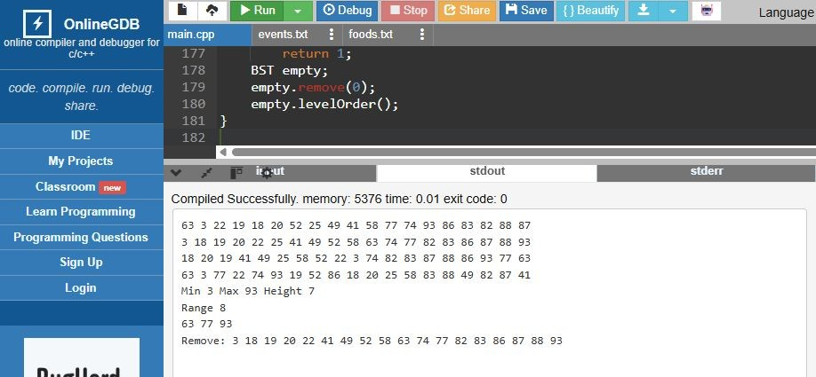

# Лабораторная работа 9

**Дисциплина:** Алгоритмы и структуры данных  
**Институт:** Институт информационных технологий и кибербезопасности  
**Кафедра:** Программная инженерия  
**Студент:** Зорькин Арсений Станиславович  
**Группа:** ПИЖ-б-о-25-2 (1)  
**Вариант:** 12  
**Уровень:** Средний по объёму (в методичке уровни не выделены)  
**Тема:** Бинарное дерево. Обходы. BST

[Титульный лист](title.pdf) · [Код C++](main.cpp) · [Репозиторий](https://github.com/False4041/C) · [Папка работы](https://github.com/False4041/C/tree/main/lab-09)

## Цель работы

Освоить четыре обхода дерева и операции бинарного дерева поиска.

## Задание

Реализовать обходы, путь от корня до указанного ключа, вставку, поиск, удаление и подсчёт ключей в диапазоне. Показать применение на 20 случайных числах с вводом ключа для удаления.

## Как работает программа

Меньшие ключи идут влево, большие вправо. Повторные значения пропускаются. Обходы в глубину отличаются моментом вывода узла. Обход в ширину использует очередь. При удалении узла с двумя детьми его ключ заменяется минимумом из правого поддерева.

## Сложность

Поиск, вставка, удаление, минимум, максимум и путь занимают O(h), где h — высота. Обходы и вычисление высоты занимают O(n). Подсчёт в диапазоне пропускает целые поддеревья и занимает до O(n).

## Запуск

Один файл main.cpp, стандарт C++17. [Команды сборки](../README.md#сборка).

Для примера введите 25 или используйте [input.txt](input.txt).

## Результат

[Текст вывода](output.txt) и скриншот запуска в [OnlineGDB](https://www.onlinegdb.com/online_c++_compiler) в режиме C++17.

## Вывод

Симметричный обход показывает отсортированные ключи. В примере ключ 25 найден и удалён, а обход после удаления сохраняет порядок.

## Контрольные вопросы

Ответы на вопросы методички

**1. Что такое бинарное дерево? Из каких элементов оно состоит?**

Дерево состоит из узлов и связей, каждый узел имеет не более двух детей.

**2. В чём отличие бинарного дерева от бинарного дерева поиска (BST)?**

BST дополнительно требует: все ключи слева меньше, справа больше ключа узла.

**3. Какие существуют виды обхода бинарного дерева? В чём их особенности?**

Pre-order: узел-лево-право; in-order: лево-узел-право; post-order: лево-право-узел; level-order — по уровням.

**4. Какой обход даёт отсортированную последовательность для BST?**

In-order.

**5. Какова сложность операций поиска, вставки и удаления в BST? От чего она зависит?**

O(h), где h — высота. У сбалансированного дерева h=O(log n), в худшем h=n.

**6. Что происходит с BST, если вставлять элементы в отсортированном порядке?**

Оно вырождается в цепочку, операции становятся линейными.

**7. Какие три случая нужно рассмотреть при удалении узла из BST?**

Лист удаляется; узел с одним ребёнком заменяется ребёнком; с двумя — предшественником или преемником.

**8. Как найти наименьший элемент в BST? Наибольший?**

Минимум — самый левый узел, максимум — самый правый.

**9. Как вычислить высоту бинарного дерева рекурсивно?**

Для пустого дерева 0; иначе 1+max высот детей.

**10. Что такое наименьший общий предок (LCA) двух узлов в дереве?**

Самый глубокий узел, являющийся предком обоих заданных узлов.

**11. Как проверить, является ли бинарное дерево BST?**

Рекурсивно передавать допустимые границы ключей; одной проверки непосредственных детей недостаточно.

**12. Что такое сбалансированное дерево? Почему это важно для производительности?**

Его высота логарифмическая; это ограничивает длину поиска.

**13. Как преобразовать несбалансированное BST в сбалансированное?**

Получить отсортированный in-order и рекурсивно выбирать середины интервалов.

**14. Как восстановить дерево по массиву обхода (in-order + pre-order)?**

Первый pre-order — корень. Найти его в in-order и рекурсивно восстановить левую/правую части; ключи должны быть различимы.

**15. Как реализовать итеративный (не рекурсивный) обход бинарного дерева?**

Использовать собственный stack для DFS или queue для level-order.

