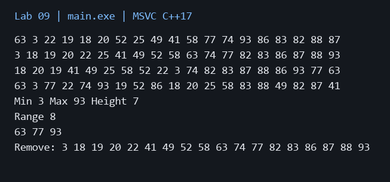

# Лабораторная работа 9

**Дисциплина:** Алгоритмы и структуры данных  
**Институт:** Институт информационных технологий и кибербезопасности  
**Кафедра:** Программная инженерия  
**Студент:** Зорькин Арсений Станиславович  
**Группа:** ПИЖ-б-о-25-2 (1)  
**Вариант:** 12  
**Уровень:** Полный вариант: в методичке нет разделения по уровням  
**Тема:** Бинарное дерево. Обходы. BST

[Титульный лист](title.pdf) · [Код C++](main.cpp) · [Репозиторий](https://github.com/False4041/C) · [Папка работы](https://github.com/False4041/C/tree/main/lab-09)

## Цель работы

Реализовать обходы бинарного дерева и BST.

## Задание

Pre-order, in-order, post-order, level-order; путь от корня. Подсчёт ключей в диапазоне. 20 случайных значений, min/max/высота и удаление введённого ключа.

## Как работает программа

Меньшие ключи лежат слева, большие справа. Повторы игнорируются. Узел с двумя детьми удаляется через замену минимальным ключом правого поддерева. Высота пустого дерева 0, листа 1.

## Сложность

Поиск/вставка/удаление/min/max/путь O(h), в худшем h=n. Обходы/высота O(n), range в худшем O(n). Память O(n), рекурсивный стек O(h), очередь обхода до O(n).

## Запуск

Один файл `main.cpp`, стандарт C++17. [Команды сборки](../README.md#сборка).

Введите целый ключ для удаления.

[Пример ввода](input.txt):

```text
25
```


## Результат

[Фактический вывод](output.txt) демонстрационного запуска; ниже изображение этого вывода.



## Особенности

В main вводится ключ удаления. Отсутствующий ключ ничего не меняет. Из-за повторов в случайных значениях узлов может быть меньше 20.

## Проверка

Сборка MSVC /W4 без предупреждений. Проверены демонстрационный запуск и граничные случаи. [Подробности проверки](../CHECKS.md).

## Вывод

Реализован вариант 12. Меньшие ключи лежат слева, большие справа. Результаты демонстрации приведены выше.

## Контрольные вопросы

<details>
<summary>Ответы на вопросы методички</summary>

**1. Что такое бинарное дерево? Из каких элементов оно состоит?**

Дерево состоит из узлов и связей, каждый узел имеет не более двух детей.

**2. В чём отличие бинарного дерева от бинарного дерева поиска (BST)?**

BST дополнительно требует: все ключи слева меньше, справа больше ключа узла.

**3. Какие существуют виды обхода бинарного дерева? В чём их особенности?**

Pre-order: узел-лево-право; in-order: лево-узел-право; post-order: лево-право-узел; level-order — по уровням.

**4. Какой обход даёт отсортированную последовательность для BST?**

In-order.

**5. Какова сложность операций поиска, вставки и удаления в BST? От чего она зависит?**

O(h), где h — высота. У сбалансированного дерева h=O(log n), в худшем h=n.

**6. Что происходит с BST, если вставлять элементы в отсортированном порядке?**

Оно вырождается в цепочку, операции становятся линейными.

**7. Какие три случая нужно рассмотреть при удалении узла из BST?**

Лист удаляется; узел с одним ребёнком заменяется ребёнком; с двумя — предшественником или преемником.

**8. Как найти наименьший элемент в BST? Наибольший?**

Минимум — самый левый узел, максимум — самый правый.

**9. Как вычислить высоту бинарного дерева рекурсивно?**

Для пустого дерева 0; иначе 1+max высот детей.

**10. Что такое наименьший общий предок (LCA) двух узлов в дереве?**

Самый глубокий узел, являющийся предком обоих заданных узлов.

**11. Как проверить, является ли бинарное дерево BST?**

Рекурсивно передавать допустимые границы ключей; одной проверки непосредственных детей недостаточно.

**12. Что такое сбалансированное дерево? Почему это важно для производительности?**

Его высота логарифмическая; это ограничивает длину поиска.

**13. Как преобразовать несбалансированное BST в сбалансированное?**

Получить отсортированный in-order и рекурсивно выбирать середины интервалов.

**14. Как восстановить дерево по массиву обхода (in-order + pre-order)?**

Первый pre-order — корень. Найти его в in-order и рекурсивно восстановить левую/правую части; ключи должны быть различимы.

**15. Как реализовать итеративный (не рекурсивный) обход бинарного дерева?**

Использовать собственный stack для DFS или queue для level-order.

</details>
