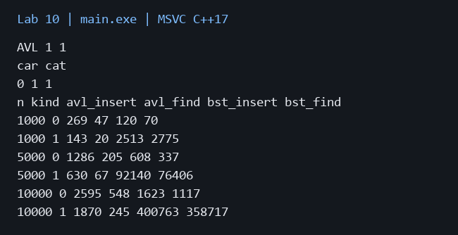
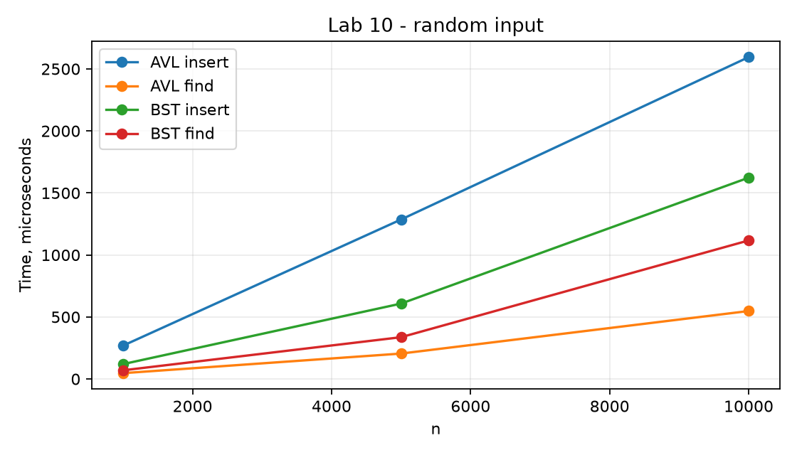

# Лабораторная работа 10

**Дисциплина:** Алгоритмы и структуры данных  
**Институт:** Институт информационных технологий и кибербезопасности  
**Кафедра:** Программная инженерия  
**Студент:** Зорькин Арсений Станиславович  
**Группа:** ПИЖ-б-о-25-2 (1)  
**Вариант:** 12  
**Уровень:** Полный вариант: в методичке нет разделения по уровням  
**Тема:** AVL-дерево. Префиксное дерево (Trie)

[Титульный лист](title.pdf) · [Код C++](main.cpp) · [Репозиторий](https://github.com/False4041/C) · [Папка работы](https://github.com/False4041/C/tree/main/lab-10)

## Цель работы

Реализовать AVL и Trie, сравнить AVL с BST.

## Задание

AVL: удаление с балансировкой, построение из массива. Trie: маска ?. Сравнить вставку и поиск на случайных и упорядоченных ключах.

## Как работает программа

AVL хранит высоты и выполняет повороты. valid проверяет порядок, высоты и баланс. В Trie переходы представлены map; ? соответствует одному символу. Удаление сохраняет префиксы других слов.

## Сложность

AVL insert/search/remove O(log n), память O(n). BST O(h), на возрастающих ключах O(n). Trie insert/search/remove O(L log σ); маска в худшем посещает всё подходящее поддерево. Память Trie пропорциональна числу символов уникальных префиксов.

## Запуск

Один файл `main.cpp`, стандарт C++17. [Команды сборки](../README.md#сборка).

Без ввода: запустите программу для демонстрации.

## Результат

[Фактический вывод](output.txt) демонстрационного запуска; ниже изображение этого вывода.

## Измерения

| n | kind | avl_insert | avl_find | bst_insert | bst_find |
| --- | --- | --- | --- | --- | --- |
| 1000 | 0 | 269 | 47 | 120 | 70 |
| 1000 | 1 | 143 | 20 | 2513 | 2775 |
| 5000 | 0 | 1286 | 205 | 608 | 337 |
| 5000 | 1 | 630 | 67 | 92140 | 76406 |
| 10000 | 0 | 2595 | 548 | 1623 | 1117 |
| 10000 | 1 | 1870 | 245 | 400763 | 358717 |

Один запуск: Windows x64, MSVC 19.44, C++17, /O2. Время зависит от ПК и нагрузки; 0 означает меньше одной микросекунды. [Данные CSV](timing.csv).

## Особенности

Время в микросекундах. kind=0 — перемешанные ключи, kind=1 — возрастающие. Деревья не хранят повторы. Trie допускает пустую строку.

## Проверка

Сборка MSVC /W4 без предупреждений. Проверены демонстрационный запуск и граничные случаи. [Подробности проверки](../CHECKS.md).

## Вывод

Реализован вариант 12. AVL хранит высоты и выполняет повороты. Результаты демонстрации приведены выше.

## Контрольные вопросы

Ответы на вопросы методички

**1. AVL-дерево**

AVL — сбалансированное бинарное дерево поиска, сохраняющее разницу высот детей не более 1.

**2. Что такое AVL-дерево? В чём его отличие от обычного BST?**

В отличие от обычного BST, AVL автоматически восстанавливает баланс после изменений.

**3. Что такое фактор баланса? Как он вычисляется?**

Разность высот левого и правого поддеревьев; здесь норма от −1 до 1.

**4. Какие существуют типы поворотов в AVL-дереве?**

Одинарные левый/правый и двойные лево-правый/право-левый повороты.

**5. Когда применяется правый поворот? Левый поворот?**

Правый — при перевесе левого внешнего поддерева, левый — правого внешнего.

**6. Когда применяется левый-правый поворот? Правый-левый?**

Двойной поворот нужен при внутреннем перевесе: левый-правый или правый-левый.

**7. Какова сложность операций в AVL-дереве?**

Поиск, вставка и удаление O(log n).

**8. Почему AVL-дерево называется самобалансирующимся?**

Оно само выполняет повороты после вставок и удалений, сохраняя ограничение высот.

**9. Как часто происходит балансировка при вставке?**

Высоты проверяются по пути к корню; после вставки достаточно одного одинарного или двойного исправления первого нарушения.

**10. Чем AVL-дерево отличается от красно-чёрного дерева?**

AVL строже ограничивает высоту. Красно-чёрное дерево использует цвета и более мягкий баланс, часто уменьшая расходы на обновления.

**11. В каких случаях AVL-дерево эффективнее BST?**

При неблагоприятном порядке вставок и когда важна гарантированная скорость поиска.

**12. Префиксное дерево (Trie)**

Trie хранит строки по общим префиксам и подходит для словарей, масок и автодополнения.

**13. Что такое Trie (префиксное дерево)? Для решения каких задач оно используется?**

Рёбра соответствуют символам, путь от корня задаёт префикс. Конечный флаг отличает слово от его начала.

**14. Какова сложность поиска в Trie? От чего она зависит?**

Зависит от длины L и способа переходов. Здесь map даёт O(L log σ), массив фиксированного алфавита — O(L).

**15. Какая структура данных эффективнее для строк: Trie или хеш - таблица?**

Хеш-таблица удобна для точного поиска, Trie — для префиксов и масок; расход памяти зависит от данных.

**16. Как реализовать автодополнение с помощью Trie?**

Найти узел префикса, затем обойти его поддерево и собрать слова.

**17. Каковы недостатки Trie? Какой объём памяти он требует?**

Много мелких узлов и переходов. Память пропорциональна суммарному числу символов уникальных префиксов плюс накладные расходы.

