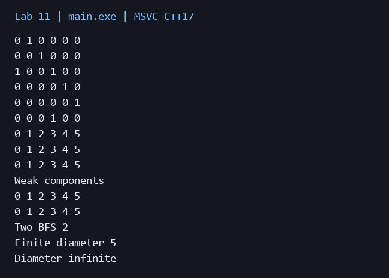

# Лабораторная работа 11

**Дисциплина:** Алгоритмы и структуры данных  
**Институт:** Институт информационных технологий и кибербезопасности  
**Кафедра:** Программная инженерия  
**Студент:** Зорькин Арсений Станиславович  
**Группа:** ПИЖ-б-о-25-2 (1)  
**Вариант:** 12  
**Уровень:** Полный вариант: в методичке нет разделения по уровням  
**Тема:** Представление графов. DFS и BFS

[Титульный лист](title.pdf) · [Код C++](main.cpp) · [Репозиторий](https://github.com/False4041/C) · [Папка работы](https://github.com/False4041/C/tree/main/lab-11)

## Цель работы

Реализовать граф, обходы и кратчайший путь.

## Задание

Ориентированный граф с петлями, матрица смежности. Рекурсивный DFS, BFS, диаметр через два BFS, компоненты и путь.

## Как работает программа

Матрица сохраняет направления рёбер. DFS реализован рекурсивно и через stack. BFS хранит родителей для восстановления пути. Компоненты считаются слабыми: при их поиске направление игнорируется.

## Сложность

Матрица O(V²) памяти. Добавление/удаление ребра O(1). DFS/BFS по матрице O(V²), память O(V); итеративный стек может содержать O(E) записей. Точный диаметр через BFS из каждой вершины O(V³).

## Запуск

Один файл `main.cpp`, стандарт C++17. [Команды сборки](../README.md#сборка).

Первая строка: n m, далее m пар from to, затем start target.

[Пример ввода](input.txt):

```text
6 7
0 1
1 2
2 0
2 3
3 4
4 5
5 3
0 5
```


## Результат

[Фактический вывод](output.txt) демонстрационного запуска; ниже изображение этого вывода.



## Особенности

Два BFS гарантируют диаметр дерева, но не произвольного ориентированного графа. Two BFS — результат требуемого приёма; Finite diameter вычисляется точно по достижимым парам. При недостижимых парах полный диаметр обозначается infinite.

## Проверка

Сборка MSVC /W4 без предупреждений. Проверены демонстрационный запуск и граничные случаи. [Подробности проверки](../CHECKS.md).

## Вывод

Реализован вариант 12. Матрица сохраняет направления рёбер. Результаты демонстрации приведены выше.

## Контрольные вопросы

<details>
<summary>Ответы на вопросы методички</summary>

**1. Что такое граф? Из каких элементов он состоит?**

Граф — множество вершин и соединяющих их рёбер.

**2. Чем отличается ориентированный граф от неориентированного?**

У ориентированного ребра есть направление, у неориентированного связь двусторонняя.

**3. Что такое матрица смежности? Каковы её достоинства и недостатки?**

Матрица хранит факт или вес ребра для каждой пары. Проверка O(1), но память O(V²).

**4. Что такое список смежности? Каковы его достоинства и недостатки?**

Список хранит только соседей. Память O(V+E), но поиск конкретного ребра обычно требует просмотра соседей.

**5. В каких случаях лучше использовать матрицу смежности, а в каких - список смежности?**

Матрица удобна для плотных графов и частых проверок пары; списки — для разреженных.

**6. Какова сложность проверки наличия ребра в матрице смежности? В списке смежности?**

Матрица O(1), обычный список O(deg(v)).

**7. Какова сложность перебора всех соседей вершины в матрице смежности? В списке смежности?**

Матрица O(V), список O(deg(v)).

**8. Что такое поиск в глубину (DFS)? Как он работает?**

DFS идёт как можно глубже, затем возвращается и исследует оставшиеся ветви.

**9. Какие задачи решаются с помощью DFS?**

Достижимость, компоненты, циклы, топологический порядок и другие задачи структуры графа.

**10. Что такое поиск в ширину (BFS)? Как он работает?**

BFS использует очередь и посещает вершины слоями по расстоянию от источника.

**11. Какие задачи решаются с помощью BFS?**

Кратчайшие пути в невзвешенном графе, расстояния и достижимость.

**12. В чём отличие рекурсивной реализации DFS от итеративной?**

Рекурсивный использует стек вызовов, итеративный — явно созданный стек.

**13. Почему BFS находит кратчайший путь в невзвешенном графе, а DFS - нет?**

BFS обрабатывает сначала все пути меньшей длины, DFS может сначала уйти по длинной ветви.

**14. Как найти компоненты связности графа с помощью DFS?**

Запускать обход из каждой ещё не посещённой вершины. Для ориентированного графа отдельно определять слабую или сильную связность.

**15. Как проверить наличие цикла в графе с помощью DFS?**

В ориентированном графе ребро в серую вершину означает цикл. В неориентированном учитывают родительское ребро.

</details>
