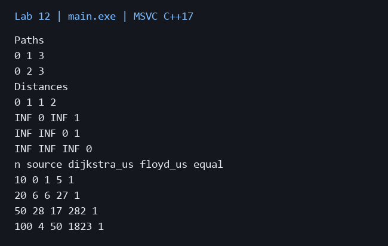
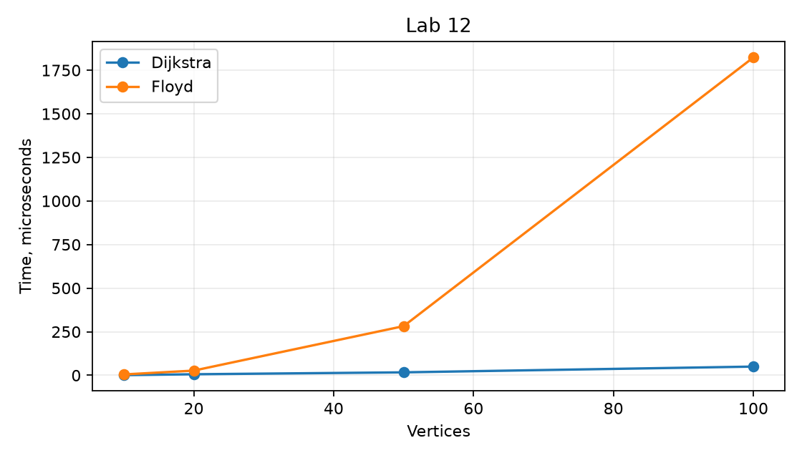

# Лабораторная работа 12

**Дисциплина:** Алгоритмы и структуры данных  
**Институт:** Институт информационных технологий и кибербезопасности  
**Кафедра:** Программная инженерия  
**Студент:** Зорькин Арсений Станиславович  
**Группа:** ПИЖ-б-о-25-2 (1)  
**Вариант:** 12  
**Уровень:** Полный вариант: в методичке нет разделения по уровням  
**Тема:** Алгоритм Дейкстры. Алгоритм Флойда-Уоршелла

[Титульный лист](title.pdf) · [Код C++](main.cpp) · [Репозиторий](https://github.com/False4041/C) · [Папка работы](https://github.com/False4041/C/tree/main/lab-12)

## Цель работы

Реализовать и сравнить алгоритмы кратчайших путей.

## Задание

Дейкстра с priority_queue и всеми кратчайшими путями. Флойд для ориентированного графа; сравнение V=50, измерения V=10,20,50,100.

## Как работает программа

Дейкстра использует список смежности и пропускает устаревшие записи очереди. Все простые кратчайшие пути восстанавливаются по допустимым предшественникам. Флойд последовательно разрешает промежуточные вершины. Сравниваются расстояния из одного источника.

## Сложность

Дейкстра O((V+E) log V) для простого графа, память O(V+E). Преобразование матрицы O(V²) выполнено до замера. Флойд O(V³), память O(V²). Число кратчайших путей может быть экспоненциальным; стек их перечисления O(V).

## Запуск

Один файл `main.cpp`, стандарт C++17. [Команды сборки](../README.md#сборка).

Без ввода: запустите программу для демонстрации.

## Результат

[Фактический вывод](output.txt) демонстрационного запуска; ниже изображение этого вывода.

## Измерения

| n | source | dijkstra_us | floyd_us | equal |
| --- | --- | --- | --- | --- |
| 10 | 0 | 1 | 5 | 1 |
| 20 | 6 | 6 | 27 | 1 |
| 50 | 28 | 17 | 282 | 1 |
| 100 | 4 | 50 | 1823 | 1 |

Один запуск: Windows x64, MSVC 19.44, C++17, /O2. Время зависит от ПК и нагрузки; 0 означает меньше одной микросекунды. [Данные CSV](timing.csv).

## Особенности

Генератор seed=12, случайные веса положительные. INF — нет пути. Дейкстра измеряется из одной вершины, Флойд для всех пар: объём решаемых задач различается.

## Проверка

Сборка MSVC /W4 без предупреждений. Проверены демонстрационный запуск и граничные случаи. [Подробности проверки](../CHECKS.md).

## Вывод

Реализован вариант 12. Дейкстра использует список смежности и пропускает устаревшие записи очереди. Результаты демонстрации приведены выше.

## Контрольные вопросы

Ответы на вопросы методички

**1. Какие условия должны выполняться для корректной работы алгоритма Дейкстры?**

Веса неотрицательны, источник существует, суммы расстояний не переполняют выбранный тип.

**2. Почему алгоритм Дейкстры не работает с отрицательными весами?**

Отрицательное ребро может улучшить уже окончательно выбранное расстояние, нарушая жадное обоснование.

**3. Какова временная сложность алгоритма Дейкстры с приоритетной очередью?**

Для списка смежности и двоичной кучи O((V+E) log V) на простом графе.

**4. В чём заключается идея алгоритма Флойда-Уоршелла?**

Последовательно разрешать промежуточные вершины k и обновлять d[i][j]=min(d[i][j],d[i][k]+d[k][j]).

**5. Какова временная сложность алгоритма Флойда-Уоршелла?**

O(V³).

**6. Как алгоритм Флойда -Уоршелла обнаруживает отрицательные циклы?**

После обработки отрицательное d[v][v] указывает на отрицательный цикл.

**7. В каких случаях предпочтительнее использовать алгоритм Дейкстры?**

Для одного или нескольких источников, особенно на разреженных графах без отрицательных весов.

**8. В каких случаях предпочтительнее использовать алгоритм Флойда-Уоршелла?**

Для всех пар и умеренного V; допускает отрицательные рёбра при корректной обработке отрицательных циклов.

**9. Как восстановить кратчайший путь после выполнения алгоритма Дейкстры?**

Хранить родителя при улучшении расстояния; для всех путей — всех подходящих предшественников.

**10. Как восстановить кратчайший путь после выполнения алгоритма Флойда-Уоршелла?**

Хранить next или промежуточную вершину для каждой пары и последовательно восстанавливать переходы.

**11. Что такое релаксация в контексте алгоритмов поиска кратчайших путей?**

Проверка, можно ли улучшить расстояние через рассматриваемое ребро.

**12. Как можно оптимизировать алгоритм Дейкстры для разреженных графов?**

Использовать список смежности и priority_queue, пропускать устаревшие записи.

**13. Какую память требует алгоритм Флойда-Уоршелла?**

O(V²).

**14. При каком количестве вершин алгоритм Флойда -Уоршелла становится неприменимым?**

Жёсткого порога нет: он зависит от памяти и времени. Кубический рост часто делает тысячи вершин дорогими.

**15. Как модифицировать алгоритм Дейкстры для нахождения второго кратчайшего пути?**

Хранить два лучших различных расстояния для каждой вершины и расширить релаксацию; отдельно определить, разрешены ли повторные вершины пути.

