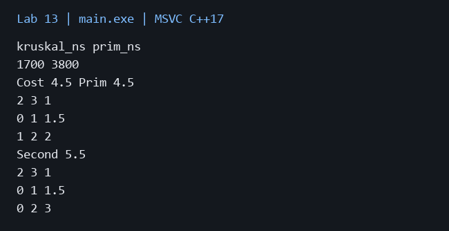

# Лабораторная работа 13

**Дисциплина:** Алгоритмы и структуры данных  
**Институт:** Институт информационных технологий и кибербезопасности  
**Кафедра:** Программная инженерия  
**Студент:** Зорькин Арсений Станиславович  
**Группа:** ПИЖ-б-о-25-2 (1)  
**Вариант:** 12  
**Уровень:** Полный вариант: в методичке нет разделения по уровням  
**Тема:** Алгоритмы Прима и Краскала. Минимальное остовное дерево

[Титульный лист](title.pdf) · [Код C++](main.cpp) · [Репозиторий](https://github.com/False4041/C) · [Папка работы](https://github.com/False4041/C/tree/main/lab-13)

## Цель работы

Построить минимальную сеть и второй остов.

## Задание

Прим с priority_queue, вещественные веса. Краскал с DSU, второй минимальный остов. Стоимость дорог, выбранные рёбра и компоненты несвязного графа.

## Как работает программа

Краскал сортирует рёбра и соединяет разные компоненты DSU. Прим выбирает дешёвое ребро на границе построенного дерева. Для второго остова поочерёдно запрещается каждое ребро первого и повторяется Краскал.

## Сложность

Прим O(E log E+V), для простого связного графа O((V+E) log V). Краскал O(E log E); DSU с рангами и сжатием путей почти O(1) амортизированно. Второй остов O(VE log E). Память O(V+E).

## Запуск

Один файл `main.cpp`, стандарт C++17. [Команды сборки](../README.md#сборка).

Первая строка: n m, далее m строк from to weight. Граф неориентированный.

[Пример ввода](input.txt):

```text
4 6
0 1 1.5
1 2 2
2 3 1
0 3 4
0 2 3
1 3 3.5
```


## Результат

[Фактический вывод](output.txt) демонстрационного запуска; ниже изображение этого вывода.



| Алгоритм | Время на примере, нс |
| --- | --- |
| Краскал | 1700 |
| Прим | 3800 |

Один короткий запуск не позволяет сделать общий вывод о скорости.

## Особенности

Второй остов отличается набором рёбер, но его вес может быть равен первому. Если другого дерева нет, No second tree. Несвязный граф даёт лес и компоненты. Вершины 0..n−1; параллельные рёбра различаются id.

## Проверка

Сборка MSVC /W4 без предупреждений. Проверены демонстрационный запуск и граничные случаи. [Подробности проверки](../CHECKS.md).

## Вывод

Реализован вариант 12. Краскал сортирует рёбра и соединяет разные компоненты DSU. Результаты демонстрации приведены выше.

## Контрольные вопросы

<details>
<summary>Ответы на вопросы методички</summary>

**1. Что такое минимальное остовное дерево (MST)?**

Остов связного неориентированного графа с минимальной суммой весов.

**2. Какие свойства имеет минимальное остовное дерево?**

Соединяет все V вершин, содержит V−1 ребро и не имеет циклов; минимизирует суммарный вес.

**3. В чём заключается идея алгоритма Прима?**

Расти от вершины, каждый раз добавляя самое дешёвое ребро в ещё не включённую вершину.

**4. Какова временная сложность алгоритма Прима на матрице смежности?**

O(V²).

**5. Какова временная сложность алгоритма Прима с приоритетной очередью?**

Для простого связного графа O((V+E) log V); в реализации с очередью рёбер общая оценка O(E log E+V).

**6. В чём заключается идея алгоритма Краскала?**

Рассматривать рёбра по возрастанию веса и добавлять только соединяющие разные компоненты.

**7. Что такое DSU и как она используется в алгоритме Краскала?**

DSU хранит непересекающиеся множества вершин и быстро проверяет, создаст ли ребро цикл.

**8. Какова временная сложность алгоритма Краскала?**

O(E log E), основная стоимость — сортировка.

**9. В каких случаях алгоритм Прима эффективнее алгоритма Краскала?**

Для плотных графов матричный Прим O(V²) может быть выгоднее сортировки всех рёбер.

**10. В каких случаях алгоритм Краскала эффективнее алгоритма Прима?**

Для разреженного графа, уже имеющегося списка рёбер или построения остовного леса.

**11. Как проверить, что построенное дерево является минимальным?**

Проверить связность и отсутствие циклов, затем для каждого нетривиального ребра сравнить его вес с максимумом на пути в дереве.

**12. Что произойдёт, если граф не связный?**

Единого остова нет, строится минимальный остовный лес; компоненты выводятся отдельно.

**13. Как модифицировать алгоритмы для поиска максимального остовного дерева?**

Выбирать максимальные веса, например сортировать по убыванию.

**14. Где применяются MST в реальной жизни?**

Прокладка кабелей, дорог и труб, кластеризация и приближённые алгоритмы.

**15. Как найти второй по минимальности вес MST?**

Рассмотреть альтернативы с заменой рёбер. Здесь по очереди запрещается каждое ребро первого MST; минимум успешных запусков даёт другой остов.

</details>
