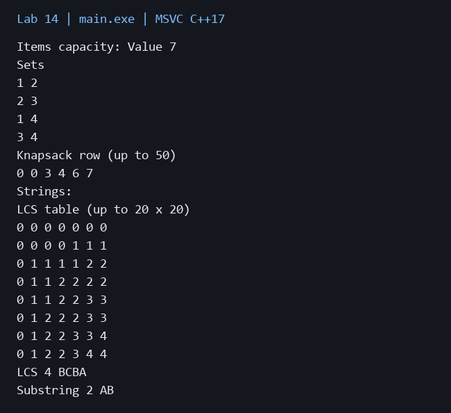

# Лабораторная работа 14

**Дисциплина:** Алгоритмы и структуры данных  
**Институт:** Институт информационных технологий и кибербезопасности  
**Кафедра:** Программная инженерия  
**Студент:** Зорькин Арсений Станиславович  
**Группа:** ПИЖ-б-о-25-2 (1)  
**Вариант:** 12  
**Уровень:** Полный вариант: в методичке нет разделения по уровням  
**Тема:** Динамическое программирование. Задача о рюкзаке. Наибольшая общая подпоследовательность (LCS)

[Титульный лист](title.pdf) · [Код C++](main.cpp) · [Репозиторий](https://github.com/False4041/C) · [Папка работы](https://github.com/False4041/C/tree/main/lab-14)

## Цель работы

Применить динамическое программирование к рюкзаку и строкам.

## Задание

Рюкзак 0/1: одномерная оптимизация и все оптимальные наборы. LCS с восстановлением и общая непрерывная подстрока. Ввод данных, результат и таблица ДП.

## Как работает программа

Рюкзак обновляет веса справа налево, поэтому предмет используется один раз. Восстановление перебирает обе оптимальные ветви с пересчётом одномерных строк. LCS допускает пропуски, общая подстрока — нет.

## Сложность

Стоимость рюкзака O(nW), память O(W). Все наборы с пересчётами: верхняя оценка O(2ⁿ·nW), память O(W+n). LCS и подстрока O(ab) по времени/памяти; восстановление LCS O(a+b).

## Запуск

Один файл `main.cpp`, стандарт C++17. [Команды сборки](../README.md#сборка).

Первая строка: n capacity, далее n строк weight value. Последние две строки — тексты для LCS.

[Пример ввода](input.txt):

```text
4 5
2 3
3 4
2 3
3 4
ABCBDAB
BDCABA
```


## Результат

[Фактический вывод](output.txt) демонстрационного запуска; ниже изображение этого вывода.



## Особенности

Предметы с 1; вес положительный, ценность неотрицательная. n≤25, W≤10000, строки до 1000 байт. Выводятся первые 51 ячейка рюкзака и первые 21×21 ячейки LCS; на маленьком примере таблицы полные.

## Проверка

Сборка MSVC /W4 без предупреждений. Проверены демонстрационный запуск и граничные случаи. [Подробности проверки](../CHECKS.md).

## Вывод

Реализован вариант 12. Рюкзак обновляет веса справа налево, поэтому предмет используется один раз. Результаты демонстрации приведены выше.

## Контрольные вопросы

<details>
<summary>Ответы на вопросы методички</summary>

**1. Что такое динамическое программирование? Какие принципы лежат в его основе?**

ДП сохраняет решения повторяющихся подзадач и использует оптимальную подструктуру.

**2. В чём разница между рекурсивным подходом с мемоизацией (top- down) и табличным (bottom-up)?**

Top-down вычисляет нужные состояния рекурсивно с кэшем; bottom-up заполняет таблицу в порядке зависимостей.

**3. Как формулируется задача о рюкзаке (0/1)?**

Выбрать каждый предмет не более раза, максимизируя стоимость при ограничении суммарного веса.

**4. Какова временная сложность решения задачи о рюкзаке методом ДП?**

O(nW), псевдополиномиальное время.

**5. Почему для оптимизации памяти нужно проходить по весам в обратном порядке?**

Обратный проход не позволяет текущему предмету использовать результат собственного добавления.

**6. Как восстановить выбранные предметы после заполнения таблицы ДП?**

Сравнивать состояния с предметом и без него. Для одномерной памяти можно пересчитывать предыдущие строки, как здесь.

**7. Как формулируется задача LCS?**

Найти самую длинную последовательность, встречающуюся в обеих строках с сохранением порядка, но с возможными пропусками.

**8. Какова временная сложность алгоритма LCS?**

Классическое табличное решение O(ab).

**9. В чём разница между подпоследовательностью и подстрокой?**

Подстрока непрерывна, подпоследовательность может пропускать символы.

**10. Как восстановить LCS после заполнения таблицы?**

Идти от конца таблицы: при совпадении брать символ и двигаться по диагонали, иначе в соседнее состояние с большим значением.

**11. Какие ещё задачи решаются с помощью ДП?**

Редакционное расстояние, размен монет, пути в DAG, цепочки матриц и другие задачи.

**12. В чём отличие задачи о рюкзаке от задачи о рюкзаке с повторениями?**

В 0/1 предмет используется не более раза; в неограниченном варианте допускаются повторы.

**13. Можно ли решить LCS за меньшее время, чем O(m×n)?**

Для некоторых структур данных и параметров есть более быстрые методы, но обычный табличный алгоритм квадратичен.

**14. Как адаптировать ДП для LCS трёх строк?**

Использовать трёхмерное состояние по префиксам строк; время и память O(abc) в прямом решении.

**15. Как модифицировать задачу о рюкзаке для случая, когда предмет можно взять несколько раз?**

Проходить вместимости по возрастанию, чтобы состояние могло повторно использовать текущий предмет.

</details>
