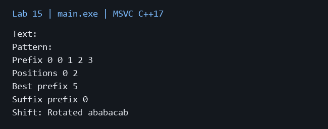

# Лабораторная работа 15

**Дисциплина:** Алгоритмы и структуры данных  
**Институт:** Институт информационных технологий и кибербезопасности  
**Кафедра:** Программная инженерия  
**Студент:** Зорькин Арсений Станиславович  
**Группа:** ПИЖ-б-о-25-2 (1)  
**Вариант:** 12  
**Уровень:** Полный вариант: в методичке нет разделения по уровням  
**Тема:** Алгоритм Кнута-Морриса-Пратта. STL (обзор)

[Титульный лист](title.pdf) · [Код C++](main.cpp) · [Репозиторий](https://github.com/False4041/C) · [Папка работы](https://github.com/False4041/C/tree/main/lab-15)

## Цель работы

Реализовать КМП и обработку через STL.

## Задание

Все вхождения, включая перекрытия; наибольшее совпадение с префиксом. Циклический сдвиг через deque и rotate.

## Как работает программа

Префикс-функция позволяет при несовпадении перейти к меньшей границе без возврата по тексту. Best prefix — максимальная длина префикса образца, встречающегося в тексте. Suffix prefix — совпадение в конце текста.

## Сложность

Префикс-функция O(m), поиск O(n+m), память O(m). Создание deque и rotate O(n), память O(n).

## Запуск

Один файл `main.cpp`, стандарт C++17. [Команды сборки](../README.md#сборка).

Три строки: текст, образец, целый сдвиг.

[Пример ввода](input.txt):

```text
abababac
ababa
2
```


## Результат

[Фактический вывод](output.txt) демонстрационного запуска; ниже изображение этого вывода.



## Особенности

Позиции с 0. Положительный сдвиг влево, отрицательный вправо. Пустой текст допустим, пустой образец отклоняется. Обработка побайтовая, примеры на латинице.

## Проверка

Сборка MSVC /W4 без предупреждений. Проверены демонстрационный запуск и граничные случаи. [Подробности проверки](../CHECKS.md).

## Вывод

Реализован вариант 12. Префикс-функция позволяет при несовпадении перейти к меньшей границе без возврата по тексту. Результаты демонстрации приведены выше.

## Контрольные вопросы

<details>
<summary>Ответы на вопросы методички</summary>

**1. В чём заключается идея алгоритма Кнута-Морриса-Пратта?**

КМП использует уже известные совпадения образца, избегая повторного просмотра текста.

**2. Что такое префикс-функция и как она вычисляется?**

pi[i] — длина самого длинного собственного префикса, равного суффиксу префикса до i. Несовпадения обрабатываются переходами pi[j−1].

**3. Какова временная сложность алгоритма КМП? Почему?**

O(n+m): индекс текста не возвращается назад, суммарное число переходов ограничено числом увеличений длины совпадения.

**4. Как работает восстановление по префикс -функции при несовпадении?**

Заменить j на pi[j−1] и проверить более короткую границу, пока не найдено совпадение или j=0.

**5. В чём преимущество КМП перед наивным алгоритмом?**

Гарантированное линейное время вместо худшего O(nm) наивного поиска.

**6. Какие контейнеры STL вы знаете? Какой контейнер когда лучше использовать?**

vector — индексный доступ; deque — оба конца; list — вставки по итератору; map/set — порядок; unordered — точечный поиск.

**7. В чём разница между vector и list?**

vector непрерывен и индексируется за O(1); list связан узлами и требует линейного индексного доступа.

**8. В чём разница между set и unordered_set?**

set хранит упорядоченные ключи с O(log n), unordered_set использует хеширование со средним O(1).

**9. В чём разница между map и unordered_map?**

map хранит упорядоченные пары ключ-значение, unordered_map — хеш-таблицу без сортированного порядка.

**10. Как работают итераторы в STL?**

Они задают позиции диапазона и набор допустимых операций; правила инвалидирования зависят от контейнера.

**11. Какие алгоритмы STL вы знаете? Приведите примеры.**

sort сортирует, find ищет, rotate сдвигает циклически, copy_if фильтрует.

**12. Что такое лямбда -выражения в C++? Как они применяются с алгоритмами STL?**

Это анонимная функция с возможным захватом переменных; например компаратор сортировки по выбранному полю.

**13. Как удалить элементы из контейнера во время итерации?**

Использовать возвращённый erase итератор и учитывать правила инвалидирования.

**14. Что такое идиома erase-remove?**

remove_if переносит сохраняемые элементы в начало, erase удаляет оставшийся хвост.

**15. Как можно изменить порядок обхода контейнера?**

Использовать обратные итераторы, reverse либо изменить порядок элементов sort/rotate.

</details>
