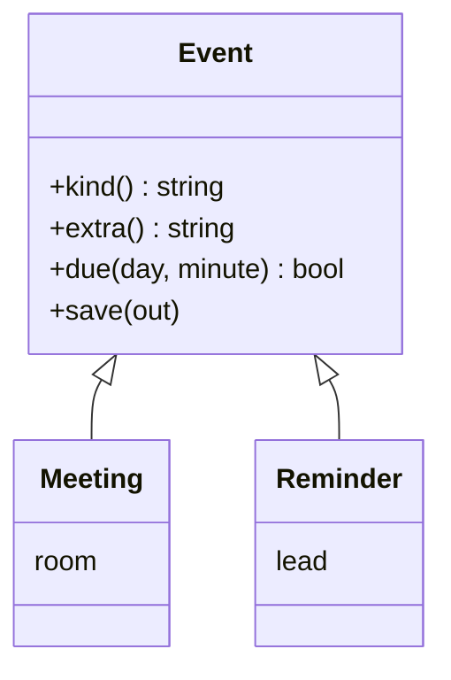
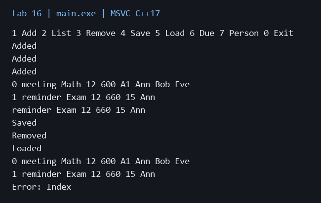

# Лабораторная работа 16

**Дисциплина:** Алгоритмы и структуры данных  
**Институт:** Институт информационных технологий и кибербезопасности  
**Кафедра:** Программная инженерия  
**Студент:** Зорькин Арсений Станиславович  
**Группа:** ПИЖ-б-о-25-2 (1)  
**Вариант:** 12  
**Уровень:** Продвинутый  
**Тема:** Проектирование иерархии классов. Наследование и полиморфизм

[Титульный лист](title.pdf) · [Код C++](main.cpp) · [Репозиторий](https://github.com/False4041/C) · [Папка работы](https://github.com/False4041/C/tree/main/lab-16)

## Цель работы

Спроектировать полиморфную иерархию событий и сохранять данные.

## Задание

Планировщик событий: напоминания, участники, наследование, полиморфизм, паттерн проектирования, сериализация и меню.

## Как работает программа

Абстрактный Event задаёт поля и виртуальные методы. Meeting хранит комнату, Reminder — интервал предупреждения. readEvent — простая фабрика. vector<unique_ptr<Event>> владеет объектами. Загрузка заменяет коллекцию только после полной проверки.

## Сложность

Добавление амортизированно O(1) без участников. Вывод/напоминания/удаление O(n). Добавление участника O(p) из-за проверки повторов. Сохранение/загрузка линейны по размеру текста. Память O(n+p).

## Запуск

Один файл `main.cpp`, стандарт C++17. [Команды сборки](../README.md#сборка).

[Пример ввода](input.txt):

```text
1 meeting "Math" 12 600 "A1" 2 "Ann" "Bob"
1 reminder "Exam" 12 660 "15" 1 "Ann"
7 0 "Eve"
2
6 12 650
4 "events.txt"
3 0
5 "events.txt"
2
3 99
0
```

| Команда | Формат |
| --- | --- |
| 1 | `1 meeting "Name" day minute "Room" count "Person"...` |
| 1 | `1 reminder "Name" day minute "Lead" count "Person"...` |
| 2 | `2` — список |
| 3 | `3 index` — удалить |
| 4 / 5 | `4 "file.txt"` / `5 "file.txt"` — сохранить / загрузить |
| 6 | `6 day minute` — активные напоминания |
| 7 | `7 index "Person"` — добавить участника |
| 0 | выход |

Индексы с 0. Строки с пробелами заключаются в кавычки.



## Результат

[Фактический вывод](output.txt) демонстрационного запуска; ниже изображение этого вывода.



## Особенности

Дни 1..31 одного месяца, minute 0..1439, lead 0..1440 минут до события. Due вызывается вручную, фонового таймера нет. Команда с данными вводится одной строкой.

## Проверка

Сборка MSVC /W4 без предупреждений. Проверены демонстрационный запуск и граничные случаи. [Подробности проверки](../CHECKS.md).

## Вывод

Реализован вариант 12. Абстрактный Event задаёт поля и виртуальные методы. Результаты демонстрации приведены выше.

## Контрольные вопросы

<details>
<summary>Ответы на вопросы методички</summary>

**1. Что такое наследование? Какие виды наследования есть в C++?**

Наследование создаёт производный класс на основе базового. По доступу бывают public, protected, private; также одиночное и множественное.

**2. Что такое открытое (public) наследование? Какое отношение оно реализует?**

Public-наследование выражает отношение «является»: Meeting является Event.

**3. Что такое виртуальный метод? Для чего он нужен?**

Виртуальный метод выбирается по фактическому типу объекта при вызове через базовый указатель или ссылку.

**4. Что такое чисто виртуальный метод и абстрактный класс?**

Чисто виртуальный метод объявляется =0. Класс с таким методом абстрактен, его нельзя создать напрямую.

**5. Почему деструктор базового класса должен быть виртуальным?**

При удалении через базовый указатель должен выполниться деструктор реального производного типа.

**6. Что такое позднее связывание (динамический полиморфизм)?**

Реализация виртуального вызова определяется во время выполнения, а не только статическим типом указателя.

**7. Как переопределить метод в производном классе? Что такое override?**

Объявить метод с той же сигнатурой и override; компилятор проверит соответствие базовому виртуальному методу.

**8. Что такое RTTI? Как работает dynamic_cast?**

RTTI предоставляет сведения о динамическом типе. dynamic_cast проверяет допустимость приведения; неудача даёт nullptr для указателя или bad_cast для ссылки.

**9. Как вызвать метод базового класса из производного?**

Записать Base::method(), например Event::print().

**10. Что такое диаграмма классов UML? Какие основные элементы?**

Она показывает классы, поля, методы и отношения наследования, композиции и ассоциации.

**11. Что такое паттерн «Стратегия»? Где он применяется?**

Стратегия выделяет взаимозаменяемый алгоритм в интерфейс; например разные способы расчёта скидки.

**12. Что такое виртуальный деструктор? Почему он важен?**

Это деструктор с virtual. Он обеспечивает корректное освобождение производного объекта через базовый тип.

</details>
