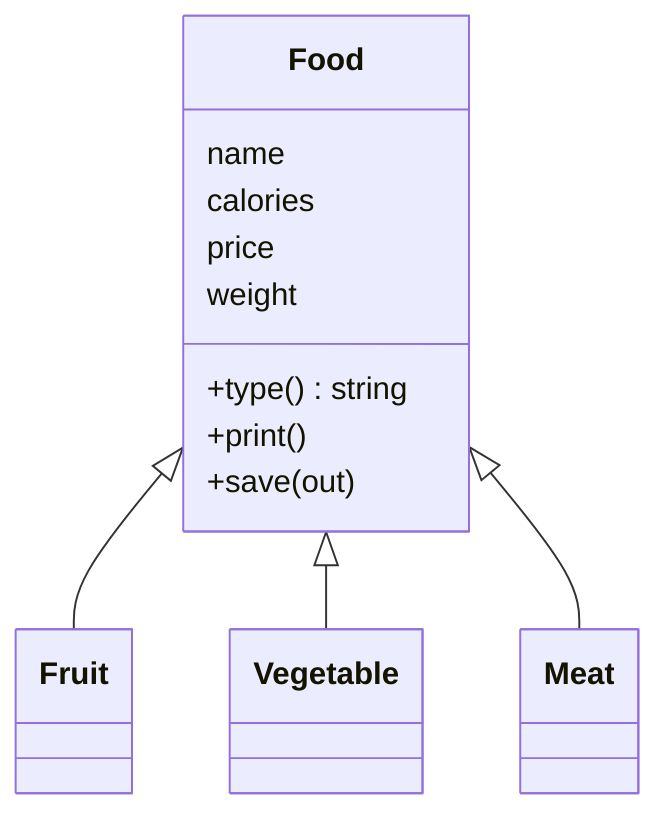
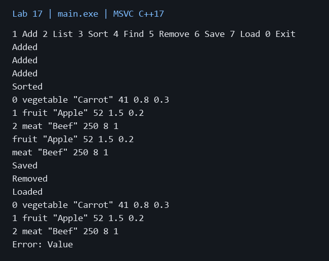

# Лабораторная работа 17

**Дисциплина:** Алгоритмы и структуры данных  
**Институт:** Институт информационных технологий и кибербезопасности  
**Кафедра:** Программная инженерия  
**Студент:** Зорькин Арсений Станиславович  
**Группа:** ПИЖ-б-о-25-2 (1)  
**Вариант:** 12  
**Уровень:** Продвинутый  
**Тема:** Реализация мини-проекта с использованием алгоритмов и структур данных

[Титульный лист](title.pdf) · [Код C++](main.cpp) · [Репозиторий](https://github.com/False4041/C) · [Папка работы](https://github.com/False4041/C/tree/main/lab-17)

## Цель работы

Создать мини-проект с STL, сериализацией и исключениями.

## Задание

«Продукты»: Fruit, Vegetable, Meat. Сортировка по калорийности, цене, весу; поиск по названию и типу. Абстрактный класс, наследники, файл, исключения, меню.

## Как работает программа

Food — абстрактная основа для трёх типов. vector<unique_ptr<Food>> хранит объекты. stable_sort сортирует по полю. Название ищется по подстроке, тип точно. quoted сохраняет пробелы, setprecision(17) сохраняет точность double.

## Сложность

Добавление амортизированно O(1), вывод/поиск/удаление O(n). stable_sort обычно O(n log n), при нехватке временной памяти может быть O(n log² n). Файлы — линейно по размеру текста. Память O(n) плюс названия.

## Запуск

Один файл `main.cpp`, стандарт C++17. [Команды сборки](../README.md#сборка).

[Пример ввода](input.txt):

```text
1 fruit "Apple" 52 1.5 0.2
1 vegetable "Carrot" 41 0.8 0.3
1 meat "Beef" 250 8 1
3 1
2
4 1 "App"
4 2 "meat"
6 "foods.txt"
5 0
7 "foods.txt"
2
1 fruit "Bad" -1 1 1
0
```

| Команда | Формат |
| --- | --- |
| 1 | `1 type "Name" calories price weight` |
| 2 | `2` — список |
| 3 | `3 field` — 1: калории, 2: цена, 3: вес |
| 4 | `4 1 "Name"` / `4 2 "type"` — поиск |
| 5 | `5 index` — удалить |
| 6 / 7 | `6 "file.txt"` / `7 "file.txt"` — сохранить / загрузить |
| 0 | выход |

Индексы с 0. Команда вводится целиком одной строкой.



## Результат

[Фактический вывод](output.txt) демонстрационного запуска; ниже изображение этого вывода.



## Особенности

Калории на 100 г, цена за единицу, вес в кг. Значения конечны и неотрицательны. invalid_argument — поля, out_of_range — индекс, runtime_error — команды/файлы. Ошибка загрузки не стирает данные. Типы: fruit, vegetable, meat.

## Проверка

Сборка MSVC /W4 без предупреждений. Проверены демонстрационный запуск и граничные случаи. [Подробности проверки](../CHECKS.md).

## Вывод

Реализован вариант 12. Food — абстрактная основа для трёх типов. Результаты демонстрации приведены выше.

## Контрольные вопросы

<details>
<summary>Ответы на вопросы методички</summary>

**1. Что такое сериализация? Для чего она нужна?**

Сериализация преобразует состояние объектов в сохраняемое представление для файла или передачи.

**2. Какие способы сериализации в C++ вы знаете?**

Текстовые потоки, бинарные форматы и структурированные форматы через библиотеки. Здесь используются стандартные текстовые потоки.

**3. В чём преимущества и недостатки текстовой сериализации?**

Текст читаем и удобен для проверки, но больше по объёму и требует разбора/экранирования.

**4. В чём преимущества и недостатки бинарной сериализации?**

Бинарный формат компактнее и быстрее, но требует учитывать типы, порядок байтов, версии и переносимость.

**5. Что такое исключение? Для чего нужен механизм исключений?**

Исключение сообщает об ошибке вне обычного возвращаемого результата и передаёт управление обработчику.

**6. Какие конструкции используются для работы с исключениями (try, catch, throw)?**

throw создаёт сигнал, try ограничивает проверяемый блок, catch обрабатывает подходящий тип.

**7. В чём разница между catch (const std::exception& e) и catch (...)?**

Первый ловит наследников std::exception и даёт what(), второй ловит любые типы без типизированного доступа к сведениям.

**8. Какие стандартные классы исключений вы знаете?**

invalid_argument, out_of_range, runtime_error, overflow_error, bad_alloc.

**9. Как создать собственный класс исключения?**

Унаследовать класс от std::exception или runtime_error и задать диагностическое сообщение.

**10. Почему деструкторы не должны выбрасывать исключения?**

Во время раскрутки стека второе необработанное исключение может привести к terminate; ресурсы освобождают безопасно.

**11. Как обрабатывать ошибки ввода данных пользователем с помощью исключений?**

Проверить разбор и диапазоны, бросить исключение, перехватить его в цикле меню и позволить повторить ввод.

**12. Как обрабатывать ошибки при работе с файлами с помощью исключений?**

Проверять открытие, чтение и завершение записи. Сообщать ошибку без замены корректных данных неполной загрузкой.

**13. Что такое RAII? Как он связан с исключениями?**

RAII связывает ресурс со временем жизни объекта. Деструкторы освобождают его и при выходе по исключению.

**14. Как обрабатывать ошибки выделения памяти (std::bad_alloc)?**

Перехватывать bad_alloc там, где возможно восстановление, освобождать ненужные данные; не пытаться продолжить недостроенную операцию.

**15. В каких ситуациях в вашем проекте используются исключения?**

Неверный тип продукта/поля/индекс, неизвестная команда, лишние данные, ошибка открытия/чтения/записи. Загрузка сначала проверяет временную коллекцию.

</details>
